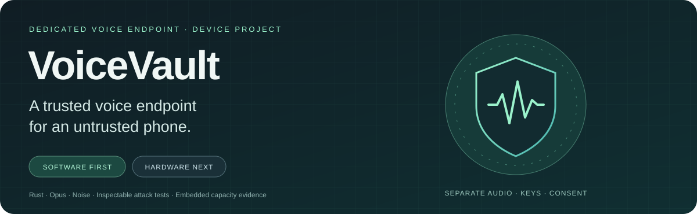
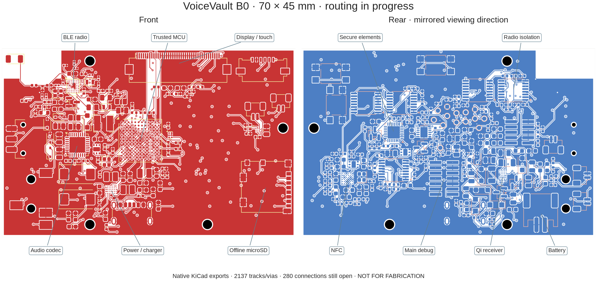
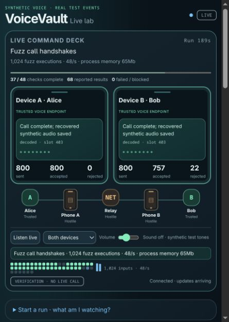

<p align="center"></p>

# VoiceVault

**A dedicated encrypted voice device, being developed and tested in software before hardware is built.**

A phone can be an excellent communications modem and an unsafe place to handle a private conversation. VoiceVault explores a different boundary: put the microphone path, audio codec, encryption keys, verified contacts and call approval inside a separate device. Give the phone encrypted media to forward.

The intended adversary has **NSA-class capabilities**: both phones may already be completely compromised through Pegasus-like spyware, zero-day or zero-click exploits, and telecommunications and relays may be controlled by the attacker. **Supply-chain attacks are excluded from the current threat model.** The project starts after phone compromise; it does not attempt to prevent or reproduce the exploit that compromised the phone.

**Today:** working Rust voice simulations, hostile-phone processes, lifecycle security models, a live device-and-test dashboard and a linked Cortex-M33 diagnostic. **Destination:** a small independent voice endpoint with its own trusted display, wired headset audio, battery, inductive charging and a carefully isolated BLE connection to a phone. No physical VoiceVault device has been built.

[Project vision](docs/PROJECT_VISION.md) · [Architecture](docs/ARCHITECTURE.md) · [Threat model](docs/THREAT_MODEL.md) · [Every security control](docs/SECURITY_CONTROLS.md) · [Why these algorithms](docs/CRYPTOGRAPHY.md) · [Test evidence](docs/RESULTS.md) · [Hardware roadmap](docs/ROADMAP.md) · [Hybrid call security](docs/POST_QUANTUM.md)

## Hardware laboratory

The active **[standalone B0 design](hardware/rev-b/README.md)** is a custom **70 × 45 mm SMD PCB** using the identified Safe 7 core ICs, plus wired audio, physical microphone disconnect, offline microSD, trusted display/touch, battery/Qi circuits and separate MCU/radio debug interfaces. Native KiCad now contains **296 electrical components, 14 probe pads and four mounting holes**. KiCad is connected locally through MCP; **ngspice 47** runs the circuit experiments directly.



*Official FreeRouting 2.5.0 produced a complete-board SES checkpoint, imported into the live KiCad editor through kipy without changing any of the 314 placements. After copper refill, native KiCad reports 280 open connections, 33 layout errors and 100 warnings. [Actual routing result and DRC](hardware/evidence/2026-11-12/autoroute/README.md). Earlier checks cover MCU ball/function mapping and circuit correspondence; the circuit models include 799 passive/static cases. [Evidence and limits](hardware/evidence/2026-11-12/README.md)*

The subsequent [Quilter cloud trial](hardware/evidence/2026-11-13/quilter/routed-return/README.md) finished at **89% routed**, but native review with the original rules found **103 unfinished connections, 294 layout errors and 117 warnings**. It remains isolated for automatic repair and rerouting; it has not replaced the live board. Returned files, hashes, the screenshot and the complete native findings are preserved for review.

**Manufacturing remains blocked:** 280 connections remain unrouted and the latest native DRC failed. Exact sourcing and the HDI stackup need acceptance, and power/RF/audio/charging/isolation need physical qualification. The [circuit inventory](hardware/rev-b/circuit-inventory.csv) is not an approved JLCPCB BOM. [Cost comparison for four assemblies delivered to Sweden](hardware/rev-b/MANUFACTURING_COST.md). No board has been ordered or built. The earlier DK2 carrier and Nucleo assessment remain historical reference work in the [hardware laboratory](hardware/README.md).

## The idea: move the endpoint

An ordinary encrypted calling app processes plaintext on the phone. Once an attacker controls that operating system, network encryption alone cannot protect audio the operating system can already access.

VoiceVault's intended device owns the sensitive endpoint. Contacts are verified there, calls are approved there, and audio is encoded and encrypted there before reaching the phone. The phone carries encrypted records and necessary signaling; it does not become a trusted authority for identities, consent, keys, time, entropy or firmware.

This distinction depends on the physical audio path. The proposed host-phone arrangement includes removing its microphones and speakers, keeping voice on an external wired headset connected to VoiceVault, and validating remaining acoustic pickup paths. An unmodified compromised phone nearby can still record speech through its own microphone. [Why a separate device, and its limits](docs/DEVICE_RATIONALE.md)


*Architecture illustration. Analog audio and BLE are hardware targets; current calls use synthetic audio and bounded local IPC. Public signaling and transport metadata remain observable.*

## A real software foundation

The lab makes two endpoints conduct a simultaneous encrypted voice exchange through two hostile phone processes and a relay. It uses actual Opus and actual cryptography, produces recovered WAV files, injects delivery faults, and records results for inspection.

| Built and exercised | What it establishes |
|---|---|
| Two voice endpoints and three hostile transport processes | A concrete separation between trusted audio/key handling and untrusted delivery, under a trusted Linux host |
| Confirmed enrollment, pinned contacts and signed invitations | Explicit identity, consent, replay and accepted-call binding rules |
| Real Opus → Noise encryption → hostile transport → authentication → decode | An executable media pipeline, including loss and malformed-input handling |
| Stored-contact, entropy, radio and offline-update models | Testable device-local policy before selecting physical chips |
| The same trusted crates compiled without `std` and linked for Cortex-M33 | Functional CPU execution and measured memory fit under a named capacity budget |
| An event-backed dashboard with searchable individual results | Visible checks, named test outcomes, attack traces and saved replays |

A tested model is not a finished hardware protection. The [assurance case](docs/ASSURANCE.md) states which assumptions each result depends on.

## The threat model and the protections

The attacker may observe, drop, replay, modify, reorder, delay and inject traffic; collude across both phones and relays; impersonate contacts; flood ingress; and try to turn malformed messages into unauthorized device actions. The design also tests a malicious authenticated peer, because having a valid key does not make compressed audio harmless.

| Attack or failure | Protection in the software model | Boundary |
|---|---|---|
| Intercept or modify voice | ChaCha20-Poly1305 under authenticated Noise transport keys | Trusted endpoints and sound implementations are assumed |
| Substitute a peer during enrollment | Noise XX, signed identity/DH records, full transcript comparison and confirmation on both sides | Trusted local comparison is required; hardware UI is future work |
| Spoof a contact or call invitation | Pinned Ed25519 identity, recipient binding, boot challenge, expiry and persisted counters | Invitation metadata itself is not confidential |
| Reuse a different invitation for an authenticated call | The hybrid Noise prologue binds the signed offer and acceptance and both verified identities | Local approval remains separate from remote signaling |
| Save encrypted calls for future quantum decryption | Fresh X25519 and ML-KEM-768 establish each call, with the hybrid suite required | Depends on the hybrid construction, trusted endpoints and erasure |
| Replay media or poison the replay window | Monotonic sending, directional keys, authenticated counter/slot checks and a bounded replay bitmap | Invalid input cannot commit incoming replay state |
| Activate audio through the phone | Local consent plus encrypted Confirm/Ready; no radio mic/consent opcode | Actual headset and physical disconnect still need validation |
| Infer speech or silence from record length | CBR Opus, DTX off, fixed 128-byte records and encrypted filler | Call boundaries, timing errors, location and correlation remain visible |
| Exhaust queues or force a burst after a stall | Bounded ingress, assembly and jitter queues; expiry; absolute deadlines; missed slots discarded | A hostile network can still deny service |
| Roll back stored contacts or signaling counters | Owner-bound AEAD snapshots tied to a protected monotonic generation | Protected storage is modeled, not a chip driver |
| Push firmware through the phone | No remote updater; locally authorized signed-image policy | Physical boot/update enforcement remains future hardware work |
| Install an old, corrupt or wrong-device image | Target/version/hash/signature checks, protected floor, two banks and readback | Real flash and counter atomicity are unmeasured |
| Interrupt an offline update | Preserve the active bank, write header last, verify before boot/version handoff | Tests cover modeled write cuts and selected torn writes |
| Weaken randomness through the phone | Onboard-only entropy-source interface, failure checks and two-source policy | Hardware entropy quality and independence need measurement |
| Keep using a closed or expired session | Irreversible close, owned key destruction, bounded media epoch and fresh handshake | Complete erasure and seamless renewal remain open |

The [complete control register](docs/SECURITY_CONTROLS.md) links each protection to its code, evidence, assumptions and remaining hardware work.

## Why these cryptographic choices?

| Choice | Role and reason |
|---|---|
| **X25519** | Compact Diffie–Hellman key exchange with fresh per-call ephemeral secrets; separate from signing identities |
| **ML-KEM-768** | Adds a fresh post-quantum secret for each call using the portable `libcrux-ml-kem` implementation |
| **Ed25519** | Signed identities, contact bindings, invitations and offline-image authorization |
| **ChaCha20-Poly1305** | Established authenticated encryption for voice and stored snapshots; suitable for portable software implementations |
| **BLAKE2s** | A 32-bit-oriented hash for the selected Noise suite, domain-separated bindings and firmware digests |
| **Noise's HMAC/HKDF-BLAKE2s** | An established transcript-bound key schedule and separate transport keys for each direction |
| **Noise XX / KKhfs through Snow** | XX for first enrollment and the experimental hybrid KK modifier for calls between pinned contacts |
| **Opus** | Practical speech compression; hard CBR and no DTX work with the outer fixed-size envelope |
| **Rust with `no_std` integration** | Safe parsing/state code and bounded interfaces that can migrate toward embedded firmware |

The hybrid suite is required for new calls. Both peers authenticate the full exchange and its algorithm suite before local consent and encrypted confirmation open audio. ML-KEM-768 is an explicit exception to the owner’s preference to avoid NIST algorithms where practical. [Protocol and wire format](docs/POST_QUANTUM.md) · [Cryptographic rationale](docs/CRYPTOGRAPHY.md)

## Evidence you can inspect

The hybrid v2 run on **2026-11-11** passed **all 11 required groups and 48 checks**. The suite recorded 68 named outcomes, including five bounded Kani checks, and ran eight fuzz campaigns for at least 120 seconds each. It also checked 80 ML-KEM-768 vectors. The altered-startup scenario verifies that a compromised phone cannot open either audio path by modifying the key exchange.

| Recorded result | Observation |
|---|---|
| Real encrypted audio | Both directions recovered generated audio through two hostile phone processes and a relay |
| Cortex-M33 execution | Hybrid startup, fragmentation and 32 Opus frames executed in QEMU |
| Linked image and observed stack | 863,104 bytes of a 983,040-byte slot and 84,876 bytes of a 131,072-byte stack reserve |
| Reference memory budget | 37,500 bytes unassigned after static state and stack/display/driver reservations |

[Latest raw results](docs/evidence/hybrid-v2/) · [What each fuzz target tests](docs/FUZZING.md) · [All recorded runs](docs/RESULTS.md) · [Embedded fit](docs/PLATFORM.md)

<p align="center"></p>

*Actual dashboard capture during hybrid handshake fuzzing. The device panels show the earlier live call in the same run. [Live call capture](docs/screenshots/command-deck-live-laptop.png) · [Historical full-suite completion](docs/screenshots/voicevault-complete.png)*

## See what is happening as it happens

The UI opens at **http://127.0.0.1:8765/** for every run. Two device panels show identity/contact verification, invitation authentication, call establishment, encrypted media, receiver rejection and audio playout/concealment. Both hostile phones and the relay are shown between them. The test area reports every scheduled check, individual Rust tests, all twelve Opus vectors, each bounded proof and actual fuzzing counters as their harnesses report them.

`./lab demo --seconds 30` gives two visible 30-second normal/fault calls. Click **Listen live** to monitor actual decoded synthetic tones. Choose either receiver or both; sound is off by default. Device cards, graphical phones, packet/rejection flashes, a recent-event ticker and compact check/fuzz displays now occupy the top observation deck. `./lab watch` runs the complete verification suite; `./lab ui` reopens the persistent page. Refresh reconstructs the current run, reconnect resumes events, and a new published run resets the display. Compilation, proofs and fuzzing are shown as checks rather than invented device traffic. Scored timing keeps graphics still and labels its buffered packet traces recorded. A running test is never displayed as a pass merely because it started. [How the dashboard works](docs/LIVE_DASHBOARD.md)

## Toward the physical device

The intended device has a trusted color display and controls, analog headset jack, independent battery, inductive charging and a separate BLE controller. Persistent secrets and protected state should use appropriate secure-element capabilities. A small protected first-stage verifier and physically initiated offline updates are part of the intended boot design. The inspiration is the Safe 7 separation of host and sensitive operations; this is an independent voice design with different workloads and requirements.

The next hardware work is to finish the standalone B0 placement and routing, review power/clock/RF/return paths, finalize exact sourcing and prepare a controlled bring-up plan. Focused simulations guide the measurements needed on physical prototypes. Real-time audio, radio containment, hardware entropy, durable storage, trusted UI and acoustic leakage need physical evidence. Decentralized signaling, possibly through interchangeable Nostr relay adapters, remains a future investigation. The proposed clear glitter enclosure and signed reference photos are separate physical tamper-evidence research.

[Device vision](docs/PROJECT_VISION.md) · [Hardware comparison](docs/DEVICE_RATIONALE.md) · [Safe 7 reference and prototype plan](docs/HARDWARE_PLAN.md) · [Roadmap and decision gates](docs/ROADMAP.md)

## Try the software lab

```sh
git clone https://github.com/adlererik/voicevault.git
cd voicevault
./lab help
./lab demo
./lab watch --out /absolute/path/to/an/empty/directory
./lab ui       # reopen the same persistent local dashboard
./lab status
./lab replay
```

The demo opens **http://127.0.0.1:8765/** and defaults to two eight-second live calls (use `--seconds 30` for longer observation): normal encrypted delivery, then deliberate media corruption and loss. The display represents Alice and Bob as trusted device panels, with both hostile phones and the relay between them. It uses synthetic audio and local processes. It requires no microphone, phone, cloud calling service, model API or paid API. `watch` runs the complete suite with a read-only loopback dashboard; test starts, reported outcomes, fuzzing counters and proof results stream as they arrive. Timing measurements keep graphics still while progress remains visible; their packet traces are labeled recorded. The saved HTML works offline. The development host is Linux x86-64; the full suite needs the pinned Rust/tooling and ARM emulator described in the [development guide](docs/DEVELOPMENT.md).

## Explore and contribute

Start with the [documentation map](docs/README.md). The six Rust crates separate state, cryptography/protocol policy, audio, device behavior, framing and the native lab. `platform/` holds the freestanding ARM diagnostic; `fuzz/` holds the eight campaigns; `scripts/` runs the checks and dashboard. These boundaries are intended to support a growing firmware and hardware project.

Useful work includes protocol review, state-machine verification, long-running fuzzing, codec/embedded interoperability, pairing usability, controller isolation, storage transactions and measurable hardware requirements. [Contribution guide](CONTRIBUTING.md) · [Security reporting](SECURITY.md)

VoiceVault was previously named **VoxBastion** and originally **Quietlink Lab**. Historical evidence, crate names and unchanged authenticated domains retain their original identifiers. Hybrid calls use a versioned VoiceVault domain and deliberately reject the classical call format.

**Security posture:** an experimental project with a concrete threat model and inspectable evidence. Independent review of the hybrid handshake, complete memory erasure, seamless key renewal and hardware validation remain open. The project does not claim immunity to an intelligence agency or readiness for sensitive production calls. [Assurance case](docs/ASSURANCE.md)
