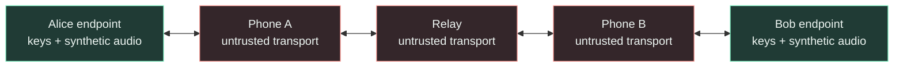
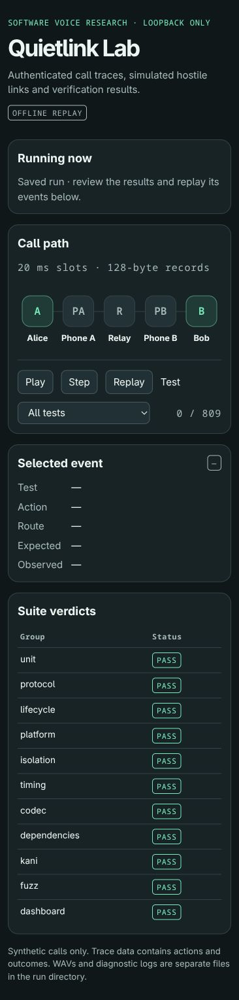
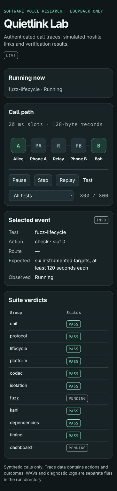
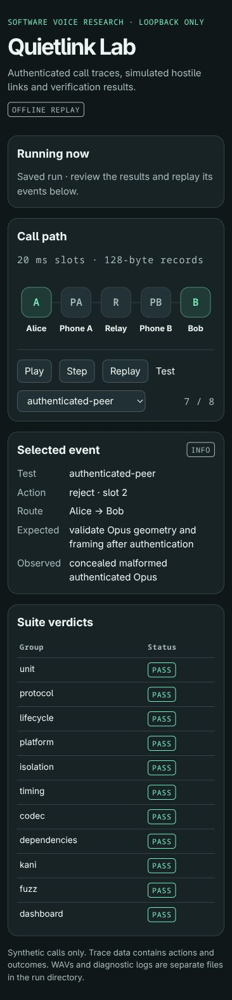

# Quietlink Lab

**A local secure-voice research lab that treats the phones and relay as hostile transport.**

Quietlink Lab investigates a separate voice endpoint that owns its audio processing, contact verification, call consent, and encryption keys. The phone's intended job is to carry ciphertext between endpoints. This repository implements the software model and its verification tools: two Rust endpoints, two simulated phones, a relay, adversarial tests, synthetic audio, and a graphical results dashboard.

**Current stage:** a software-only prototype with native Linux calls and a linked Cortex-M33 diagnostic executing under QEMU. There is no physical Quietlink device, real microphone integration, BLE implementation, or deployed calling network in this repository. The device architecture is the direction being investigated; the measurements apply to the named native or CPU-emulation experiment. The threat model assumes NSA-capability compromise of both phones and telecommunications control. **Supply-chain attacks are excluded.**

[Security design](docs/SECURITY_DESIGN.md) · [Why a separate device?](docs/DEVICE_RATIONALE.md) · [Threat model](docs/THREAT_MODEL.md) · [Assurance case](docs/ASSURANCE.md) · [Platform fit](docs/PLATFORM.md) · [Verified results](docs/RESULTS.md) · [Screenshots](docs/screenshots/README.md)

## Why this project exists

End-to-end encryption protects a conversation between its endpoints. An encrypted calling app normally still needs the phone and its audio stack to process the conversation. If that endpoint is compromised, protecting the network traffic alone does not protect audio already available inside it.

Quietlink explores moving that sensitive work into a smaller, purpose-built endpoint with its own trusted audio path and local controls. In a future hardware implementation, the general-purpose phone would receive encrypted records rather than microphone samples or call keys. The lab tests the protocol and resource boundaries that such a design would need.

This is a specialized trust-boundary proposal. Modern phones already have significant security protections, and established apps such as Signal already provide end-to-end encrypted calls. The proposed benefit is reducing dependence on the phone for plaintext audio and key handling. The [device comparison](docs/DEVICE_RATIONALE.md) explains when that could matter and which hardware requirements remain unimplemented.

## How the lab works



Alice and Bob exchange signed challenge/counter/expiry-bound invitations, bind their accepted invitation transcript into an authenticated Noise session, confirm local consent, encode generated audio, encrypt it, and authenticate received records before decoding them. The two phones and relay forward bounded Unix datagrams. They are separate processes in the wall-clock scenarios and are restricted by a Linux seccomp policy.

A trusted supervisor supplies the simulated out-of-band identity pins and local consent over separate control sockets. The hostile transport processes do not inherit those sockets. The supervisor and host OS remain trusted; this is a process-isolation model, not protection from a compromised host kernel.

## Security measures

| Measure | Implementation | Purpose and boundary |
| --- | --- | --- |
| Pairing | Noise XX, full 256-bit transcript fingerprint comparison on both trusted displays, mutual encrypted confirmation | Implements enrollment in tests and the ARM diagnostic; native wall calls model prior verified out-of-band enrollment. |
| Sealed contacts | Eight bounded slots, ChaCha20-Poly1305 snapshots, owner binding, protected generation, revocation and persisted signaling counters | Rejects tampering and rollback under the modeled protected-root assumption. |
| Invitation authentication | Ed25519 signatures over peers, recipient boot challenge, counters, expiry and call nonce | Authenticates trusted caller names and binds accepted signaling to the Noise handshake; admission work is bounded. |
| Contact authentication | Ed25519 signature binding an identity public key to a separate static X25519 public key | Prevents key substitution after the expected identity has been independently verified. |
| Session establishment | Snow with `Noise_KK_25519_ChaChaPoly_BLAKE2s` | Authenticates peers with already-pinned static keys and derives transport secrets. |
| Encryption and integrity | ChaCha20-Poly1305 authenticated encryption | Conceals record contents and rejects invalid authentication tags. |
| Handshake hashing and key derivation | BLAKE2s with Noise's HMAC/HKDF construction | Binds handshake state and derives traffic keys. |
| Call and direction separation | Fresh OS-random ephemeral keys; separate Noise split keys per direction | Separates calls and avoids sharing a key/nonce pair across opposite directions. |
| Key lifecycle | Zeroizing owned keys, irreversible close, five-minute epoch limit and fresh-handshake restart | Limits media key use. Seamless renewal and complete dependency/stack erasure remain open. |
| Nonce and replay discipline | Explicit sequence, monotonic sending, a 64-sequence replay bitmap, and media-slot bounds | Rejects duplicate/stale records, counter poisoning, and nonce reuse in the tested session paths. |
| Local consent | Trusted local approval plus authenticated Confirm/Ready exchange | Audio stays unavailable until the state transition completes. Remote pairing, mic, debug, and update commands are outside the accepted media protocol. |
| Reduced activity leakage | Fixed 128-byte active-slot records, CBR Opus, DTX off, encrypted filler | Speech, silence, and mute do not change active-slot record length. Timing, duration, direction, and missing traffic remain visible. |
| Bounded media processing | Authentication before decode; size/channel/duration checks; bounded queues and fragment assembly | Limits work and memory exposed to hostile delivery and malformed audio from a valid peer. |
| Hostile radio boundary | Single bounded data command, fixed queue, quotas, expiry and reset/update-mode rules | Contains software ingress authority; no real BLE or hardware isolation is claimed. |
| Offline updates | Local action, signed raw image/target/version/hash, two banks, protected rollback floor, readback and header-last write | Tests interrupted installation and rollback through abstract flash/counter interfaces. |
| Onboard entropy model | MCU plus two secure-element source interfaces, two passing sources, basic failure checks and monotonic generation | Phone entropy is excluded; actual source quality and independence are unmeasured. |
| Worker confinement | Linux x86-64 seccomp allowlist and inherited connected IPC only | Blocks file opens, new network connections, endpoint-memory inspection, and descriptor transfer after confinement. |
| Verification evidence | Locked graphs, Clippy, reference vectors, proptest, cargo-deny, fuzzing, Kani, timing gates | Reports explicit PASS/FAIL/BLOCKED results within each check's scope. |

The [security design](docs/SECURITY_DESIGN.md) explains every control, the packet layout, key lifecycle, consent sequence, isolation policy, implementation entry points, and primary specifications.

## Screenshots

Actual browser captures from the **2026-11-10 phase-two run**. The first and third show the completed eleven-group results; the middle capture shows the real live view while the extended fuzz campaigns were still running. These are software test views, not hardware photos.

<table>
  <tr><th>Completed eleven-group suite</th><th>Live verification progress</th><th>Authenticated malformed audio</th></tr>
  <tr>
    <td><a href="docs/screenshots/phase2-overview.jpg"></a></td>
    <td><a href="docs/screenshots/phase2-live.jpg"></a></td>
    <td><a href="docs/screenshots/phase2-authenticated-peer.jpg"></a></td>
  </tr>
</table>

The dashboard supports Pause, Step, Replay, and test filtering. Its live view identifies the running check and animates actual recorded sends, drops, tampering, replays, and receiver responses. Streaming and animation pause during timing measurements. The saved HTML embeds the events and needs no server. [Gallery and scenario explanations](docs/screenshots/README.md)

## What has been verified

The fresh complete phase-two run **passed all 11 required groups**: unit, protocol, lifecycle, platform, codec, isolation, fuzz, Kani, dependencies, timing and dashboard. Its run-specific verdict and measurements are recorded in [complete results](docs/RESULTS.md) and the [machine-readable summary](docs/verification-summary.json).

The suite includes published Noise KK and XX vectors against the actual selected crypto resolver, 18 lifecycle/fault/property tests, six fuzz targets at least 120 seconds each, four bounded Kani harnesses, libopus interoperability, all 12 applicable official mono decoder vectors, and an in-place constructor comparison. Native idle and CPU-contention calls retain the p99 send-error ≤ 5 ms and missed-slot ≤ 0.1% gates.

The ARM diagnostic executes real Opus, Noise, link and policy code without Linux. The recorded image occupies 707,168 bytes; static RAM including a 32 KiB reserved heap is 552,324 bytes. With a 128 KiB stack and 64 KiB future-driver/display allowance, 37,500 bytes of the 768 KiB main-RAM budget remain unassigned. The [platform report](docs/PLATFORM.md) explains flash/RAM gates, stack watermark, driver reserves and public fixture keys. Passing CPU emulation demonstrates functional paths and linked capacity. It does not establish real-time performance or hardware isolation.

## Repository structure

| Component | Responsibility |
| --- | --- |
| [`crates/call-state`](crates/call-state) | Consent/close, Confirm/Ready, replay bitmap, monotonic security counter, Kani harnesses |
| [`crates/protocol`](crates/protocol) | Enrollment, contact storage, invitations, Noise/media, entropy/radio/update policy |
| [`crates/codec`](crates/codec) | Opus profile, packet admissibility, generated audio, loss concealment |
| [`crates/device-core`](crates/device-core) | Slot scheduling, jitter buffer, endpoint media pipeline |
| [`crates/link`](crates/link) | Bounded fragmentation and reassembly |
| [`crates/lab-runner`](crates/lab-runner) | Virtual attacks, five-process calls, seccomp, codec comparison, WAVs, metrics |
| [`platform`](platform) | Linked no_std Cortex-M33 diagnostic, guarded stack, fixed capacity limits |
| [`scripts`](scripts) | Suite orchestration, dashboard, account-local C++ adapters |
| [`fuzz`](fuzz) | Six handshake, record, codec, enrollment, lifecycle, update/radio fuzz targets |
| [`vendor`](vendor) | Pinned libopus, initialization-only opus-rs port, provenance and integrity manifest |

## Run the lab

In an initialized checkout with the verification tools installed:

```sh
./lab help
./lab demo
./lab test
./lab watch --out /absolute/path/to/an/empty/directory
./lab status
./lab replay                 # last completed full run
./lab replay /path/to/run   # a saved run
```

`test` and `watch` run the same required suite. `watch` starts a read-only loopback dashboard and attempts to open the current graphical browser. The launcher resolves the repository from its own location. `--out` must identify an empty absolute directory. The full suite exits zero only if every required group passes.

The toolchain requires Linux x86-64, Python 3.11+, rustup, the exact stable pin in [`rust-toolchain.toml`](rust-toolchain.toml) with rustfmt and Clippy, the fuzz nightly selected in [`scripts/lab.py`](scripts/lab.py), cargo-deny, cargo-fuzz, Kani with its setup completed, and a C/C++ toolchain with make and ar. The launcher uses repository-local `.lab-cache/` tooling and existing account-local Rust tools. On the recorded host, Zig supplied C++ without a system package installation. The native, fuzz and platform graphs each have Cargo lockfiles. The platform check also needs the ARM Rust target, `arm-none-eabi-size`, and official QEMU with Cortex-M33 MPS2 AN505 support. See [platform setup](docs/PLATFORM.md).

The [original bootstrap](scripts/bootstrap-original.sh) is preserved for provenance. It includes source generation and targets `~/src/secure-voice-lab`; it is not a general installer for an arbitrary checkout. The implemented lab itself runs without an AI model, API key, paid calling service, microphone, or physical phone. Reference vectors download from upstream when absent from the cache.

## Saved evidence

| Artifact | Contents |
| --- | --- |
| `verdict.json` | Eleven top-level statuses, check-level reasons and log paths |
| `timing.json` | Host details, gates, send error/misses, queue peaks, CPU/codec/crypto time, memory and digital playout metrics |
| `events.ndjson` | Bounded descriptions used by the dashboard; no keys or audio payloads |
| `dashboard.html` | Self-contained offline replay with the CLI's verdicts |
| `alice-received.wav`, `bob-received.wav` | Received synthetic audio for checking content and direction |
| `platform/` | Linked capacity report, observed heap/stack, ELF sections, target dependency graph, emulator log and public-key diagnostic ELF |
| `logs/` | Diagnostic evidence for each check |

Caches, build outputs, and ordinary run directories are excluded from Git. The committed summary identifies the recorded run; fresh runs produce their own evidence.

## Boundaries and next steps

The implemented lifecycle mechanisms use software models of trusted storage, entropy sources, raw flash and protected counters. They do not implement a particular secure element, a physical immutable boot root, real BLE, analog headset I/O, acoustic protection, a production UI or a deployed call network. Nostr remains an optional future signaling carrier. The intended battery, inductive charging, wired audio, trusted color display and separate radio are described in the [device rationale](docs/DEVICE_RATIONALE.md).

Remaining security work includes independent review, complete secret-erasure analysis, durable transactional storage, long-running fuzz campaigns, seamless call-key renewal and any post-quantum requirement. A compromised phone can still deny service, expose metadata and record nearby speech through an intact microphone. Hardware timing, entropy quality, radio isolation, power and acoustic behavior need separate measurements. The [assurance case](docs/ASSURANCE.md) maps each claim to its evidence and limits.
