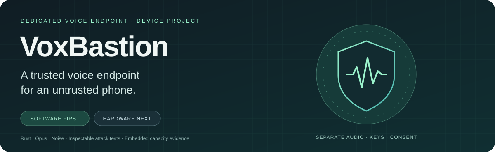
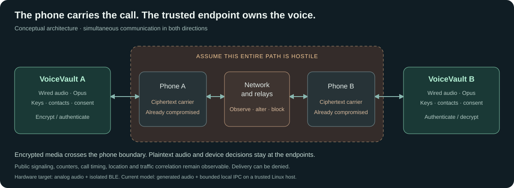
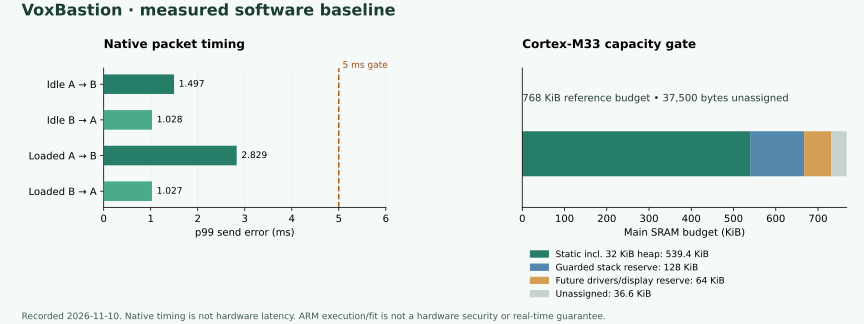
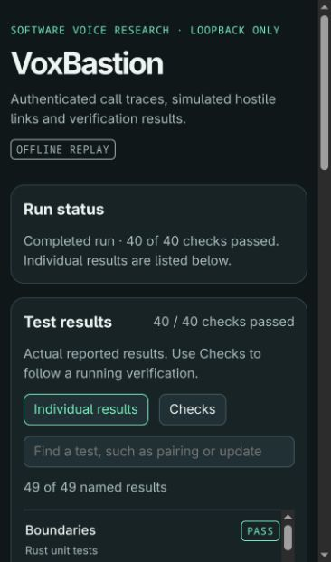
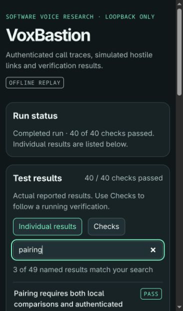

<p align="center"></p>

# VoxBastion

**A dedicated encrypted voice device, being developed and tested in software before hardware is built.**

A phone can be an excellent communications modem and an unsafe place to handle a private conversation. VoxBastion explores a different boundary: put the microphone path, audio codec, encryption keys, verified contacts and call approval inside a separate device. Give the phone encrypted media to forward.

The intended adversary has **NSA-class capabilities**: both phones may already be completely compromised through Pegasus-like spyware, zero-day or zero-click exploits, and telecommunications and relays may be controlled by the attacker. **Supply-chain attacks are excluded from the current threat model.** The project starts after phone compromise; it does not attempt to prevent or reproduce the exploit that compromised the phone.

**Today:** working Rust voice simulations, hostile-phone processes, lifecycle security models, an interactive test dashboard and a linked Cortex-M33 diagnostic. **Destination:** a small independent voice endpoint with its own trusted display, wired headset audio, battery, inductive charging and a carefully isolated BLE connection to a phone. No physical VoxBastion device has been built.

[Project vision](docs/PROJECT_VISION.md) · [Architecture](docs/ARCHITECTURE.md) · [Threat model](docs/THREAT_MODEL.md) · [Every security control](docs/SECURITY_CONTROLS.md) · [Why these algorithms](docs/CRYPTOGRAPHY.md) · [Test evidence](docs/RESULTS.md) · [Hardware roadmap](docs/ROADMAP.md)

## The idea: move the endpoint

An ordinary encrypted calling app processes plaintext on the phone. Once an attacker controls that operating system, network encryption alone cannot protect audio the operating system can already access.

VoxBastion's intended device owns the sensitive endpoint. Contacts are verified there, calls are approved there, and audio is encoded and encrypted there before reaching the phone. The phone carries encrypted records and necessary signaling; it does not become a trusted authority for identities, consent, keys, time, entropy or firmware.

This distinction depends on the physical audio path. The proposed host-phone arrangement includes removing its microphones and speakers, keeping voice on an external wired headset connected to VoxBastion, and validating remaining acoustic pickup paths. An unmodified compromised phone nearby can still record speech through its own microphone. [Why a separate device, and its limits](docs/DEVICE_RATIONALE.md)



*Architecture illustration. Analog audio and BLE are hardware targets; current calls use synthetic audio and bounded local IPC. Public signaling and transport metadata remain observable.*

## A real software foundation

The lab makes two endpoints conduct a simultaneous encrypted voice exchange through two hostile phone processes and a relay. It uses actual Opus and actual cryptography, produces recovered WAV files, injects delivery faults, and records results for inspection.

| Built and exercised | What it establishes |
|---|---|
| Two voice endpoints and three hostile transport processes | A concrete separation between trusted audio/key handling and untrusted delivery, under a trusted Linux host |
| Confirmed enrollment, pinned contacts and signed invitations | Explicit identity, consent, replay and accepted-call binding rules |
| Real Opus → Noise encryption → hostile transport → authentication → decode | An executable media pipeline, including loss and malformed-input handling |
| Stored-contact, entropy, radio and offline-update models | Testable device-local policy before selecting physical chips |
| The same trusted crates compiled without `std` and linked for Cortex-M33 | Functional CPU execution and measured memory fit under a named capacity budget |
| An event-backed dashboard with searchable individual results | Visible checks, named test outcomes, attack traces and saved replays |

A tested model is not a finished hardware protection. The [assurance case](docs/ASSURANCE.md) states which assumptions each result depends on.

## The threat model and the protections

The attacker may observe, drop, replay, modify, reorder, delay and inject traffic; collude across both phones and relays; impersonate contacts; flood ingress; and try to turn malformed messages into unauthorized device actions. The design also tests a malicious authenticated peer, because having a valid key does not make compressed audio harmless.

| Attack or failure | Protection in the software model | Boundary |
|---|---|---|
| Intercept or modify voice | ChaCha20-Poly1305 under authenticated Noise transport keys | Trusted endpoints and sound implementations are assumed |
| Substitute a peer during enrollment | Noise XX, signed identity/DH records, full transcript comparison and confirmation on both sides | Trusted local comparison is required; hardware UI is future work |
| Spoof a contact or call invitation | Pinned Ed25519 identity, recipient binding, boot challenge, expiry and persisted counters | Invitation metadata itself is not confidential |
| Reuse a different invitation for an authenticated call | Signed offer and acceptance are bound into the Noise KK prologue | Local approval remains separate from remote signaling |
| Replay media or poison the replay window | Monotonic sending, directional keys, authenticated counter/slot checks and a bounded replay bitmap | Invalid input cannot commit incoming replay state |
| Activate audio through the phone | Local consent plus encrypted Confirm/Ready; no radio mic/consent opcode | Actual headset and physical disconnect still need validation |
| Infer speech or silence from record length | CBR Opus, DTX off, fixed 128-byte records and encrypted filler | Call boundaries, timing errors, location and correlation remain visible |
| Exhaust queues or force a burst after a stall | Bounded ingress, assembly and jitter queues; expiry; absolute deadlines; missed slots discarded | A hostile network can still deny service |
| Roll back stored contacts or signaling counters | Owner-bound AEAD snapshots tied to a protected monotonic generation | Protected storage is modeled, not a chip driver |
| Push firmware through the phone | No remote updater; locally authorized signed-image policy | Physical boot/update enforcement remains future hardware work |
| Install an old, corrupt or wrong-device image | Target/version/hash/signature checks, protected floor, two banks and readback | Real flash and counter atomicity are unmeasured |
| Interrupt an offline update | Preserve the active bank, write header last, verify before boot/version handoff | Tests cover modeled write cuts and selected torn writes |
| Weaken randomness through the phone | Onboard-only entropy-source interface, failure checks and two-source policy | Hardware entropy quality and independence need measurement |
| Keep using a closed or expired session | Irreversible close, owned key destruction, bounded media epoch and fresh handshake | Complete erasure and seamless renewal remain open |

The [complete control register](docs/SECURITY_CONTROLS.md) links each protection to its code, evidence, assumptions and remaining hardware work.

## Why these cryptographic choices?

| Choice | Role and reason |
|---|---|
| **X25519** | Compact Diffie–Hellman key exchange with fresh per-call ephemeral secrets; separate from signing identities |
| **Ed25519** | Signed identities, contact bindings, invitations and offline-image authorization |
| **ChaCha20-Poly1305** | Established authenticated encryption for voice and stored snapshots; suitable for portable software implementations |
| **BLAKE2s** | A 32-bit-oriented hash for the selected Noise suite, domain-separated bindings and firmware digests |
| **Noise's HMAC/HKDF-BLAKE2s** | An established transcript-bound key schedule and separate transport keys for each direction |
| **Noise XX / KK through Snow** | XX for first enrollment; KK for calls between already pinned contacts, avoiding a new homemade handshake |
| **Opus** | Practical speech compression; hard CBR and no DTX work with the outer fixed-size envelope |
| **Rust with `no_std` integration** | Safe parsing/state code and bounded interfaces that can migrate toward embedded firmware |

Algorithm choice is only part of the design. Nonce discipline, peer verification, consent, isolation, key lifetime and failure behavior matter just as much. A 256-bit cipher key does not make the complete system 256-bit secure. The current suite is classical, not post-quantum. Avoiding NIST primitives where practical is a preference, not an assurance argument: Ed25519 uses SHA-512 and standard BLE has its own cryptographic requirements. [Detailed rationale, tradeoffs and primary references](docs/CRYPTOGRAPHY.md)

## Evidence you can inspect

The recorded phase-two run on **2026-11-10** passed **all 11 required groups and 40 checks**. Six instrumented fuzz campaigns completed **112,481 executions**, each running for 121 seconds. Four bounded Kani harnesses passed. The native run also checked both libopus interoperability directions, twelve official mono decoder vectors, and eighteen lifecycle test functions, including property tests.

| Recorded result | Observation |
|---|---|
| Idle and CPU-contention calls | Zero missed slots out of 1,500 per direction in each scenario; retained p99 send-error gate ≤ 5 ms |
| Overload and blocked phone | Intentional misses, bounded queues, no catch-up bursts |
| Cortex-M33 diagnostic | Real codec, encrypted media, link and selected policy paths executed; 32 audio frames recovered |
| Linked image / static RAM | 707,168 bytes / 552,324 bytes, including a 32 KiB reserved heap |
| Reference memory budget | 768 KiB main RAM, 128 KiB guarded stack, 64 KiB future-driver/display reserve; 37,500 bytes unassigned |

These are observations from the identified software run and CPU emulator. They do not establish physical security or real-time hardware performance. The dashboard's later presentation update exposes **49 named test/proof/vector results** extracted from the logs; some cases repeat under different build profiles.

[Full results](docs/RESULTS.md) · [Raw verdict and logs](docs/evidence/phase2/verdict.json) · [Machine-readable summary](docs/verification-summary.json) · [Embedded fit](docs/PLATFORM.md)



<table>
<tr><th>Individual test outcomes</th><th>Pairing verification</th></tr>
<tr>
<td><a href="docs/screenshots/voxbastion-tests.jpg"></a></td>
<td><a href="docs/screenshots/voxbastion-pairing.jpg"></a></td>
</tr>
</table>

*Actual dashboard captures presenting the recorded outcomes under the VoxBastion name. The plot is calculated from the committed timing and ARM reports; these presentation updates are not a new test campaign. [The gallery](docs/screenshots/README.md) also includes live campaign progress and authenticated malformed-audio handling captured under the former Quietlink Lab name.*

## Toward the physical device

The intended device has a trusted color display and controls, analog headset jack, independent battery, inductive charging and a separate BLE controller. Persistent secrets and protected state should use appropriate secure-element capabilities. A small protected first-stage verifier and physically initiated offline updates are part of the intended boot design. The inspiration is the Safe 7 separation of host and sensitive operations; this is an independent voice design with different workloads and requirements.

The software stage comes first. Hardware work follows explicit review and measurement gates, including real-time audio, radio containment, hardware entropy, durable storage, trusted UI and acoustic leakage. Decentralized signaling, possibly through interchangeable Nostr relay adapters, remains a future investigation. An optional clear glitter enclosure and signed reference-photo manifest remain physical tamper-evidence research; no supply-chain protection is claimed in the present model.

[Device vision](docs/PROJECT_VISION.md) · [Hardware comparison](docs/DEVICE_RATIONALE.md) · [Roadmap and decision gates](docs/ROADMAP.md)

## Try the software lab

```sh
git clone https://github.com/adlererik/voxbastion.git
cd voxbastion
./lab help
./lab demo
./lab watch --out /absolute/path/to/an/empty/directory
./lab status
./lab replay
```

The demo uses synthetic audio and local processes. It requires no microphone, phone, cloud calling service, model API or paid API. `watch` runs the complete suite with a read-only loopback dashboard; timing measurements deliberately pause streaming/animation. The saved HTML works offline. The development host is Linux x86-64; the full suite needs the pinned Rust/tooling and ARM emulator described in the [development guide](docs/DEVELOPMENT.md).

## Explore and contribute

Start with the [documentation map](docs/README.md). The six Rust crates separate state, cryptography/protocol policy, audio, device behavior, framing and the native lab. `platform/` holds the freestanding ARM diagnostic; `fuzz/` holds the six campaigns; `scripts/` runs the checks and dashboard. These boundaries are intended to support a growing firmware and hardware project.

Useful work includes protocol review, state-machine verification, long-running fuzzing, codec/embedded interoperability, pairing usability, controller isolation, storage transactions and measurable hardware requirements. [Contribution guide](CONTRIBUTING.md) · [Security reporting](SECURITY.md)

VoxBastion was previously named **Quietlink Lab**. Historical evidence, crate names and authenticated `quietlink` protocol domains retain their original identifiers so a branding change does not silently change the protocol or rewrite test history.

**Security posture:** an experimental project with a concrete threat model and inspectable evidence. Complete dependency/stack erasure, seamless key renewal, post-quantum protection and hardware validation remain open. The project does not claim immunity to an intelligence agency or readiness for sensitive production calls. [Assurance case](docs/ASSURANCE.md)
