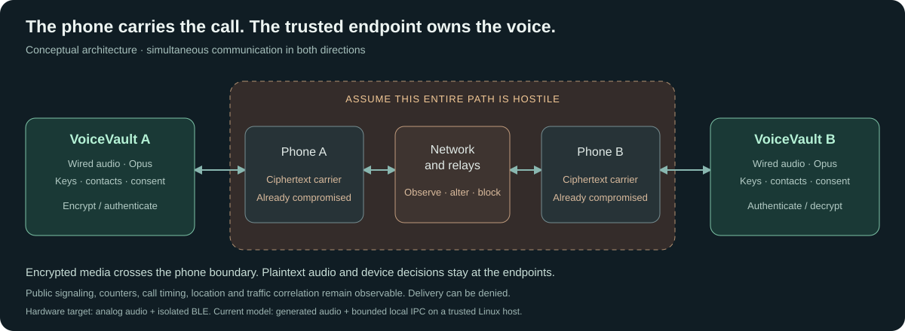

# Architecture and a complete call

VoiceVault is designed around ownership of the voice endpoint. The trusted side owns audio, contact decisions, consent and secrets. Everything carried through a phone is treated as attacker-controlled input on arrival.



## The two implementations being connected

| Layer | Executable software today | Intended hardware later |
|---|---|---|
| Audio | Generated PCM, actual Opus and recovered WAVs | Analog wired headset, ADC/DAC and physical mic disconnect |
| Trusted controls | Supervisor-only control sockets and policy APIs | Device-local display and input |
| Keys/state | Owned secret buffers and protected-state abstractions | Trusted MCU and suitable secure-element operations |
| Transport | Two hostile phone workers and a relay on bounded local datagrams | Isolated BLE controller, phone forwarding app and untrusted networks |
| Timing | Deterministic clocks and native monotonic deadlines | MCU timers, audio DMA and measured interrupt behavior |
| Update/boot | Raw flash-bank, signed-image and protected-version models | Protected first-stage verifier and physically initiated offline update |

The ARM diagnostic executes the trusted code under a memory budget; it is not an STM32 peripheral simulator or a complete hardware firmware image.

## The Rust boundaries

| Crate | Owns | Does not authorize |
|---|---|---|
| [`call-state`](../crates/call-state) | Consent/confirmation transitions, irreversible close, replay bitmap and monotonic security counter | Any transport request to activate audio |
| [`protocol`](../crates/protocol) | Identities, enrollment, invitations, sessions, records, contacts, entropy/radio/update policy | A phone-selected identity, clock, RNG or firmware trust anchor |
| [`codec`](../crates/codec) | Opus profile, admissibility checks, PCM and loss concealment | Authentication of a sender |
| [`device-core`](../crates/device-core) | Scheduling, jitter queue and the media pipeline | Unbounded media queues or catch-up bursts |
| [`link`](../crates/link) | Bounded fragmentation/reassembly and expiration | Trust in a fragment before complete record authentication |
| [`lab-runner`](../crates/lab-runner) | Native orchestration, hostile workers, attacks, metrics, reference-codec comparisons and synthetic WAVs | Hardware-security conclusions |

The trusted crates build without the Linux standard library. Platform-specific drivers and secure-element interfaces still need design; sharing the protocol does not make every chip operation a drop-in replacement.

## 1. Create and enroll an identity

Each endpoint generates independent Ed25519 signing and X25519 static secrets. Its signed 128-byte contact record binds the two public keys. Initial enrollment uses Noise XX to exchange these records and verify the DH binding. The endpoints compare the full 256-bit transcript fingerprint through a trusted local ceremony and exchange encrypted confirmations. An `EnrolledContact` is produced only after the required approvals and confirmations.

The native five-process call uses a trusted supervisor to model already-verified out-of-band enrollment. The complete XX ceremony is separately exercised by lifecycle tests, fuzzing and the ARM diagnostic. No physical pairing transport or production display UI exists yet.

## 2. Store and pin the contact

The fixed-capacity book stores up to eight contacts, bounded aliases, revocation flags and incoming/outgoing invitation counters. Snapshots are encrypted/authenticated and bound to the owner and current protected generation. Restoring a valid older snapshot is rejected. The protected root is an in-memory abstraction whose retention/atomicity is an assumption for the simulated reboot.

A phone can carry a public key, but it cannot replace the trusted pin or assign a trusted contact name through the radio interface.

## 3. Authenticate an invitation

The initiator signs an offer binding both peers, a recipient boot challenge, a fresh call nonce, counter, issued time and expiry. The recipient verifies the expected pinned signer, its own identity/challenge, trusted time and replay state before obtaining the trusted caller name. Successful counter updates are persisted before the result is released.

An acceptance repeats the call nonce and is independently signed and verified. The ordered offer and acceptance are hashed into an accepted-call context. Invitations are authenticated public signaling in this model; their fields and delivery metadata are not hidden by media encryption. The future discovery/relay adapter must be evaluated separately.

## 4. Establish a new session

Noise KKhfs uses the pinned static DH keys and fresh X25519 and ML-KEM-768 contributions. The suite name, both verified Ed25519 identities and the accepted invitation bind the exchange. Noise derives separate outgoing and incoming transport keys. The startup parser accepts only the expected 1,248-byte or 1,152-byte flight in bounded 32-byte chunks. The call refuses classical-only startup. [Protocol and wire format](POST_QUANTUM.md)

The device must also have local consent. Encrypted Confirm and Ready controls use reserved sequences 0 and 1. Only the required state transition permits media. An authenticated remote message is not local approval.

## 5. Carry the voice

```text
Outgoing trusted endpoint:
headset/PCM → Opus → bounded audio or filler → AEAD → fixed record → fragments

Untrusted path:
radio/phone A → network/relay → phone/radio B

Incoming trusted endpoint:
bounded ingress → reassembly → authenticate → replay/state/slot checks
                → jitter queue → validate Opus → decode/conceal → headset/PCM
```

Both directions run simultaneously. The phone sees ciphertext for media, public sequencing/framing and signaling/transport metadata. It may prevent delivery but is not an authority for any decrypted state.

| Record field | Bytes |
|---|---:|
| Public little-endian sequence, used as the Noise nonce | 8 |
| Encrypted record type and payload length | 2 |
| Encrypted audio/filler and zero padding | 102 |
| Authentication tag | 16 |
| **Total** | **128** |

At a 20 ms active-slot interval, records alone require 51.2 kbit/s in each direction, or 102.4 kbit/s full duplex. BLE and network overhead are extra. The simulated link fragments a record into at most 32-byte payload chunks; real BLE MTU negotiation and any additional fragmentation remain future work.

## 6. Bound bad delivery

Authentication precedes codec acceptance and replay-window commitment. Unsupported types, invalid padding, stale/replayed counters and out-of-slot media are rejected. A forged high counter cannot move the window. The receive window is 64 sequences; jitter and incomplete-assembly counts are fixed at eight. Missing/malformed media uses concealment; authenticated filler produces silence.

Absolute deadlines discard expired work. When a phone stalls, the device does not drain an ever-growing backlog in a burst. The radio boundary admits one bounded data command with quotas, expiration and no privileged opcodes. Flooding can still deny service; bounded work does not defeat an attacker that refuses to forward traffic.

The native hostile workers have only inherited connected IPC after seccomp confinement. File opens, new network connections, memory inspection and descriptor transfer are probed and denied. The host OS, trusted launcher and pre-confinement initialization remain part of the simulation's trusted base.

## 7. Close or expire the call

A close cannot be undone. At 15,000 local slots, the media epoch ends and owned transport-key objects are dropped. Restart needs a fresh authenticated handshake, not a reused session and reset counter. This version stops at the five-minute limit; seamless renewal and full erasure analysis remain open.

## Device maintenance is a separate authority

The radio has no update command. The update model requires local approval, verifies a signed exact image for the target/security version, preserves the active bank, writes payload before header into the other bank, verifies readback, and advances the protected version before boot handoff. Read or protected-commit failures propagate before an unrecognized bank can be erased.

The future microSD path will need its own bounded driver/media handling. A protected boardloader is an intended hardware trust root, not a claim that this repository has burned immutable firmware into a CPU.

## Boundary tests and next steps

[Control register](SECURITY_CONTROLS.md) maps attacks to code and evidence. [Detailed security design](SECURITY_DESIGN.md) provides policy specifics. [Platform fit](PLATFORM.md) records what actually linked/executed. [Roadmap](ROADMAP.md) lists the tests that must precede a physical endpoint.

## Observing the software laboratory

The native runner publishes sanitized lifecycle/media events during separate live scenarios. A bounded incremental subprocess-output parser reports test starts/outcomes, fuzzing statistics and proof results without waiting for process exit. A persistent read-only service follows local run journals at **127.0.0.1:8765**. It has no HTTP test-control or device-consent commands. The UI shows two software device panels, the hostile transport path and exact check/group states. Scored timing endpoints retain buffered traces; those traces are labeled recorded and graphics stay still. [Live dashboard design](LIVE_DASHBOARD.md)
