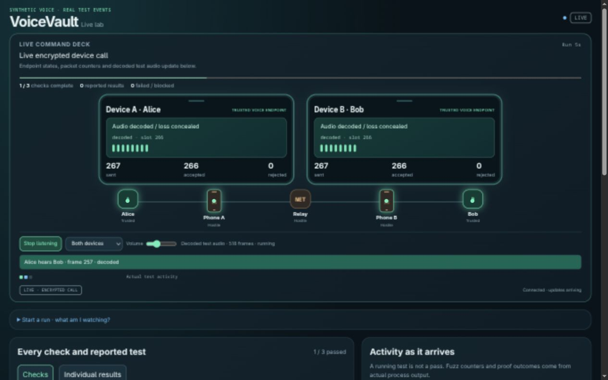

# Command deck and synthetic audio: focused verification

This follow-up moves the dynamic observation deck above long lists, adds graphical phones, event/rejection flashes, a compact check map and reported fuzz-rate chart, and supplies optional receiver-side synthetic audio monitoring. `./lab demo --seconds 30` gives enough time to observe and listen. It introduces no post-quantum cryptography.

The checks are deliberately identified as a **focused feature follow-up**, not a new complete eleven-group campaign. The [earlier full-suite baseline](RESULTS.md) remains preserved with its original source provenance. Fuzzing, Kani, ARM and dependency campaigns were not rerun for this native/UI feature patch; trusted protocol/codec/embedded crates and their dependency graphs were not changed.

| Check | Observed result |
|---|---|
| Rust workspace tests | All 30 reported cases passed |
| Clippy, all workspace targets, warnings denied | Passed |
| Dashboard/monitor regressions | Passed, including exact PCM forwarding, partial writes, bounded response, run mismatch, malformed query, inactive/timing refusal, HTTP behavior and existing progress/mapping checks |
| Two normal/fault demos, eight seconds per call | Passed; every monitor frame compared with actual receiver WAV output |
| Two normal/fault demos, thirty seconds per call | Passed with the same monitor/WAV comparison |
| Idle, CPU contention, overload, blocked phone | All four original scenario gates passed; no monitor files created |
| Browser listening | Actual decoded frames received/scheduled during the call; AudioContext running; observed 2,088 frames in the 30-second preflight |
| Compact layout | Both graphical phones and the full observation deck above the fold at 381×648; also inspected at 1280×800 |
| Browser console | No errors observed |

[Feature report and source hashes](evidence/command-deck/feature-verification.json) · [Timing/audio-exclusion results](evidence/command-deck/timing-feature-checks.json) · [Rust log](evidence/command-deck/rust-tests.log) · [Dashboard log](evidence/command-deck/dashboard.log)

The top deck ends at approximately 596.8 pixels in the measured 648-pixel narrow viewport. The laptop capture was taken while a real call was still running, with actual decoded-audio scheduling, growing packet counts and boundary flashes. The narrow capture shows a completed demo. Monitoring is off by default and was switched off after inspection. The browser's added buffer is not a latency measurement.

[Completed narrow-width deck](screenshots/command-deck-narrow-deck.png)

Audio remains generated 400/700 Hz test tones. The loopback-only PCM observation route belongs to the trusted development host, not either hostile phone. No real microphone, human conversation, public listener or phone/radio plaintext command was introduced. Scored timing does not produce or expose monitor audio. [Operation and boundaries](LIVE_DASHBOARD.md)
