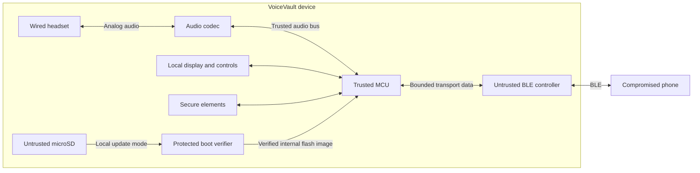

> **Current active design, 2026-11-12:** [VoiceVault standalone B0](../hardware/rev-b/README.md), STM32U5G9ZJJ6Q UFBGA144, replaces the development-board approach for the new prototype. It has a native hierarchical circuit and two-sided placement, with routing, sourcing/HDI acceptance and physical qualification incomplete. The DK2/Nucleo discussion below is historical bench planning. No hardware was fabricated.

# From the Safe 7 reference to a VoiceVault prototype

Start with a KiCad block schematic and a table that maps each interface to its trust boundary. That work can proceed in software while the protocol receives independent review. Use the schematic to decide what to model and what to measure on a development board before routing a compact custom PCB.

## What to borrow from the Safe 7

Trezor documents an STM32U5G Cortex-M33, OPTIGA Trust M and TROPIC01 secure elements, a local display, independent battery and inductive charging. Its firmware describes a permanently write-protected first-stage boardloader, hardware isolation and a locked production debug interface. These are useful references for VoiceVault's boot and trust boundaries. Use a small protected verifier, and map each secure element to concrete operations such as entropy, key protection or monotonic state before selecting parts. Require sufficient onboard entropy with the phone absent. [Safe 7 hardware](https://trezor.io/learn/security-privacy/how-trezor-keeps-you-safe/trezor-hardware-built-in-security) · [Trezor embedded architecture](https://docs.trezor.io/trezor-firmware/core/embed-arch/embed-arch.html)

The additional work for a voice device is continuous full-duplex audio. The wired headset and physical microphone disconnect belong on the trusted side, alongside the audio codec, display and call controls. A separate BLE controller should carry bounded ciphertext and public signaling through a narrow interface. The MCU must control DMA destinations and interrupt work. The radio should have no path to private audio, keys, consent, debug, update or boot-mode controls. The analog circuit, jack, radio antenna, enclosure and charging coil must be evaluated together because their physical placement affects noise, radio performance and charging. [VoiceVault threat model](THREAT_MODEL.md)

The existing QEMU run demonstrated functional Cortex-M33 execution and fit against an STM32U585-class memory budget. It did not model STM32 peripherals. An STM32U5G9-class part is a reasonable candidate to evaluate for display and driver headroom. ST lists 4 MB of flash and about 3 MB of SRAM for that family, with usable capacity depending on bank allocation and ECC. Check the exact part's memory map, protected regions, flash endurance, pin assignments and DMA access. Run the actual audio workload before choosing the chip or battery size. [Current platform evidence](PLATFORM.md) · [ST STM32U5G datasheet](https://www.st.com/resource/en/datasheet/stm32u5g9nj.pdf)

## What each tool can establish

| Tool | First useful job | Evidence still needed |
|---|---|---|
| KiCad schematic and PCB tools | Draw trusted MCU, secure elements, headset codec, display/input, battery/charging, radio and microSD as separate sheets. Label buses, power and reset lines, DMA ownership and physical approval signals. | Review schematic and routing against the isolation requirements. Measure electrical and RF behavior on a board. |
| KiCad/ngspice | Model selected microphone bias and filtering, supply transients and charging or regulator behavior when component models exist. | Validate the audio noise floor, headset levels, brownouts and charger behavior with actual parts. |
| QEMU | Keep the existing linked CPU execution and memory checks for the real voice and hybrid protocol code. | Time the complete firmware with real interrupts, DMA and peripheral traffic. |
| Renode, where models exist | Exercise firmware register access and failure sequences for selected peripherals. Check exact MCU and peripheral model availability before planning this work. Model missing interactions explicitly and record each assumption. | Confirm real peripheral behavior and hardware access controls. A peripheral stub only tests the behavior it implements. |
| Mechanical CAD | Check headset and card access, enclosure fit, antenna clearance and coil placement. | Measure acoustics, RF, charging and thermals on the assembled unit. |

There is no single simulation that validates the entire device. Use each model for a specific question and carry its untested assumptions into the bench plan. [KiCad SPICE](https://www.kicad.org/discover/spice/) · [QEMU MPS2 board model](https://www.qemu.org/docs/master/system/arm/mps2.html) · [Renode peripheral modeling](https://renode.readthedocs.io/en/latest/advanced/writing-peripherals.html)

The [STM32U5G validation plan](STM32U5G_VALIDATION.md) records the candidate device map, a tested example of an incomplete model and the model-to-board comparisons to make.

## Offline microSD update design

Treat the microSD card as untrusted storage. The user enters update mode through local physical controls. Suspend calls and disable the radio in that mode. Prefer a fixed location and a small bounded signed image format so the immutable verifier can stay small. The protected boot chain verifies the target, image length, release signature, digest and version. Stream bytes into the inactive internal flash bank using bounded buffers. Verify the programmed image from flash before marking it bootable and advancing the protected version. The processor boots only from verified internal flash. Preserve recovery from an interrupted update with an authenticated image that still meets the protected version floor. [Software update policy](../crates/protocol/src/update.rs)

The current model accepts an in-memory byte slice. The board needs a bounded streaming reader, an actual microSD driver, protected counter storage and real flash behavior. Test card removal, substitution while reading, read errors, malicious sizes, signed images for the wrong target, rollback and power cuts during writes and version advancement. Consider the electrical exposure of the card connector in the schematic. The first-stage verifier and debug controls are decisions to test on the selected silicon. [Existing lifecycle tests](../crates/protocol/tests/lifecycle.rs) · [Trezor boot architecture](https://docs.trezor.io/trezor-firmware/core/embed-arch/embed-arch.html)

## First milestone and board decision

1. Produce the block schematic and interface table with candidate parts, exact RAM/flash reservations, trusted and untrusted bus boundaries and the measurements each interface requires.
2. Keep QEMU for regression checks and use fault injection against software models of the radio, flash, card and protected counters. Add a peripheral model when it answers a question the current abstractions cannot answer.
3. When ready for physical work, use a development board and a wired audio test loop. Measure full-duplex 20 ms processing under concurrent display, interrupt and DMA load, peak stack, startup delay, audio noise and power. Exercise real BLE loss, retries, backpressure and adversarial controller traffic. The media payload alone needs 51.2 kbit/s in each direction before transport overhead. Verify the offline update path on the actual flash and power rails.
4. Use those results to choose the final parts and route the custom board. Validate RF, power, acoustic leakage, debug lockdown, real key erasure and the independent review findings on assembled hardware. The nearby compromised phone and its possible acoustic pickup remain part of the operating setup.

The first useful deliverable is a reviewable schematic and test plan that tells us which design assumptions to retire. The prototype should earn its own evidence even when it shares parts or design ideas with a wallet.

## Review-stage implementation

The [hardware laboratory](../hardware/README.md) now contains the native carrier project, candidate BOM, wiring plan, circuit models and strict observable-result gates. The [recorded run](../hardware/evidence/2026-11-11/README.md) preserves their results and open hardware requirements. The owner proposed a removable NUCLEO-U5A5ZJ-Q after the initial DK2 draft. Its [assessment](../hardware/reference/NUCLEO_U5A5_ASSESSMENT.md) records the MCU, footprint and target-verification changes to evaluate.
