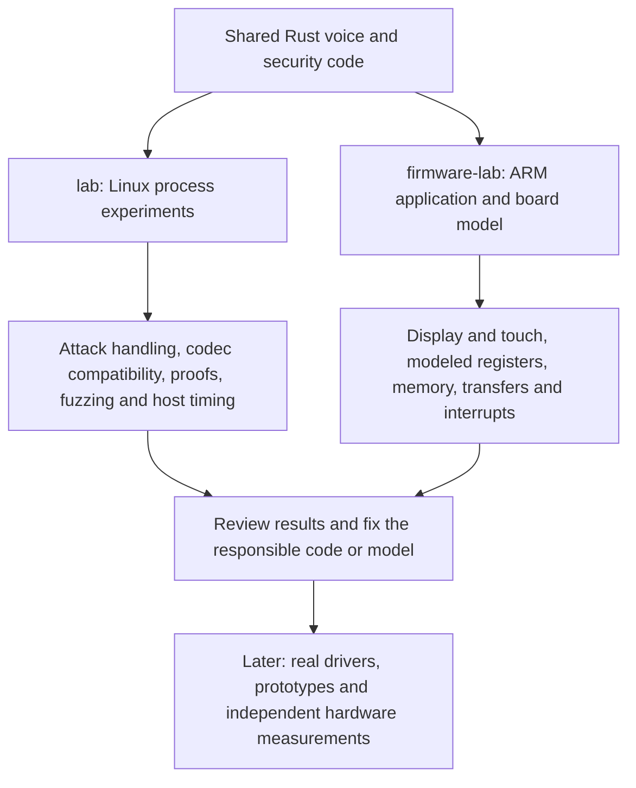
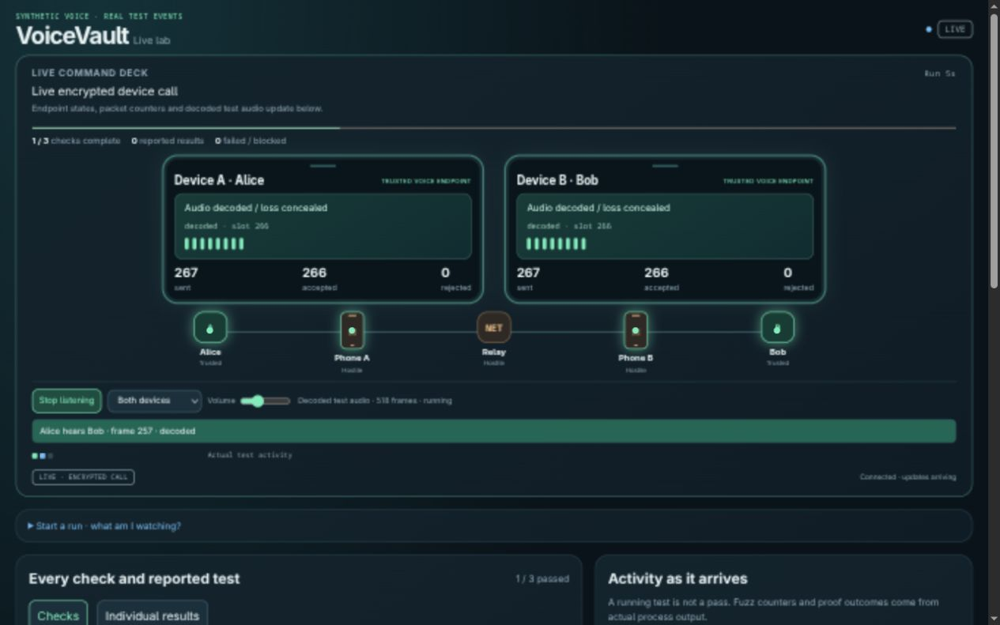
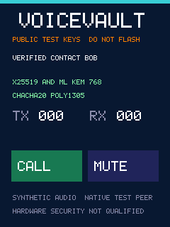

# Using VoiceVault: a guide to both laboratories

This guide explains what to run, what to click, and what the results mean. You do not need to understand electronics or cryptography to follow the walkthroughs.

**VoiceVault is still a development project.** The labs help us find faults before relying on a physical device. They do not certify a finished product. The firmware prototype uses public test keys and synthetic audio, and its timing still needs work. **Do not flash that prototype or use it for private conversations.**

## 1. Which lab do I want?

Think of the two labs as different workshops for the same device project.

| | `lab`: the voice/security workshop | `firmware-lab`: the device/board workshop |
|---|---|---|
| Main question | Does the voice protocol behave correctly when phones and transport attack it? | Does compiled ARM code interact correctly with the supported simulated board components? |
| What runs | Trusted Alice/Bob endpoints plus separate hostile Phone A, Phone B and Relay processes on Linux | Cortex-M33 ARM instructions in Renode, with a restricted model of the C1 board |
| Main page | <http://127.0.0.1:8765/> | <http://127.0.0.1:8765/firmware> |
| Quick interactive command | `./lab demo --seconds 30` | `./firmware-lab device` |
| Test command | `./lab watch` or `./lab test` | Several separate commands: base `test`, device `--self-test`, screen `--self-test` |
| What the pictures mean | An event-backed explanation of software endpoints and transport | Pixels the ARM firmware actually sends to the modeled LCD |
| Audio | Generated test audio; optional browser listening in live native calls | Offline-generated voices; buffered listening to the ARM or native receiver’s actual output |
| Main limitation | A secure process experiment is not proof of physical device security | The board model is incomplete and is not a timing-accurate replica of the chip |

**For a quick demonstration, start with `lab demo`. For the device screen and firmware application, use `firmware-lab device`.**

### What is available in GitHub?

At this documentation update on **18 November 2026**, `lab` is part of the published repository. The executable C1 firmware lab and integrated device prototype are still local development work on the configured workstation; this documentation update does **not** publish that runtime, its complete board snapshot, cached tools or a firmware release.

The firmware instructions below describe that configured workstation. If your fresh clone has no `firmware-lab` file, that is a publication gap, not a command you typed incorrectly. The terminal help/reference documents the local tool; reading the help does not install its runtime.

A clone is also not a complete tool installer. The native full suite needs the pinned Rust, fuzzing, proof and emulator tools in the [development guide](DEVELOPMENT.md). The local firmware setup additionally needs its exact C1 board/reference files, Renode, ARM build tools and private Python environment. Missing tools or changed target files must be resolved before a run can pass.

## 2. How the labs work together

Both use the project's trusted Rust building blocks for protocol rules, call state, authenticated records and audio. They exercise those blocks in different surroundings.



The native lab is useful for exploring many attacks and checking protocol changes. The firmware lab adds the processor's executable code and selected board interfaces. Bugs found in one can lead to fixes in a shared library or in a device-specific driver. After a change, rerun the relevant checks in both environments.

They are **not automatically chained together**. Running `lab watch` does not start the C1 firmware simulator. Running `firmware-lab test` does not run the native lab's security suite. The QEMU ARM capacity diagnostic inside `lab` is also different from the Renode C1 board model.

The two pages share a local dashboard service and fixed port. Their run histories and verdicts remain separate. Do not add together unrelated green indicators and treat them as one complete product qualification.

## 3. Before typing commands

Open a terminal in the project folder. On the configured workstation:

```bash
cd /home/erikclean/src/secure-voice-lab
```

For a fresh clone, open the folder where you cloned `voicevault` instead. A command beginning with `./` means “run this file in the current folder.” Both launchers resolve their own project folder internally, so their full paths can also be used from another folder.

Type help **after the program name**:

```bash
./lab --help
./lab demo --help
./lab help watch
```

On the configured firmware workstation:

```bash
./firmware-lab --help
./firmware-lab device --help
./firmware-lab help test
```

Typing only `--help` asks the shell to run a program named `--help`; it does not tell the shell which application you mean. You can also run either launcher without arguments to see its main help.

Help prints descriptions, option defaults, examples and limits. It starts no build, emulator, test or server. Native help needs only Python 3; the local firmware launcher has the same help-only behavior even when its private simulator environment is missing.

## 4. Walkthrough: watch a native voice call

### Open the page and enable optional listening

```bash
./lab ui
```

Open <http://127.0.0.1:8765/> if the browser does not open automatically. For sound, click **Listen live** before starting the demonstration. Choose the receiver you want to hear. Sound is off by default; no microphone permission or real speech is needed.

### Start the calls

```bash
./lab demo --seconds 30
```

The command builds the release program if necessary, then runs **two calls of 30 seconds each**: normal delivery and a deliberate loss/corruption scenario. Building and cleanup add time. `--seconds 30` does not mean the whole command finishes in 30 seconds. With no option, each call lasts eight seconds.

The endpoints generate different test tones, encode them with Opus, encrypt them, send them through the transport processes, authenticate incoming records and decode the received audio. The phones are treated as already hostile; this is not an installation or reenactment of Pegasus.

### Read the page

- Alice and Bob represent trusted voice endpoints. Their status comes from the executing software.
- Phone A, Phone B and Relay represent the untrusted route. The drawing does not mean a physical phone is connected.
- Sends, receiver rejections and concealment explain actual endpoint events. Intermediate hops have no separate packet telemetry.
- **Checks** shows scheduled verification work. **Individual results** shows outcomes actually reported by supported test harnesses.
- A running check has not passed yet. Packet graphics are not invented during compilation, proofs or fuzzing.



*An existing native dashboard capture. It illustrates the interface, not a new test run created by this guide.*

### Find the result

Read the output folder printed in the terminal. Demonstrations save logs, traces, recovered synthetic WAV files, a saved dashboard and `demo-verdict.json`. A successful demo says that demonstration worked; it is not a full security-suite pass.

Listening includes a small browser buffer and is not a latency measurement. During scored timing experiments, live listening is disabled and packet traces are buffered for recorded replay.

## 5. Walkthrough: run the full native suite

```bash
./lab watch
```

This runs the complete required suite with live progress. Allow substantial time: **eight fuzz campaigns alone require at least 16 minutes**, and builds, proofs, vectors and timing experiments add more. The total depends on your machine, caches and available tools.

| Group | In everyday language |
|---|---|
| `unit` | Check/build the code and exercise individual functions |
| `protocol` | Check handshakes, identities and hostile delivery scenarios |
| `lifecycle` | Exercise pairing, invitations, stored contacts, entropy and modeled updates |
| `platform` | Link/run the trusted core on a separate QEMU ARM diagnostic and check its reference memory budget |
| `codec` | Check actual audio encoding/decoding against reference implementations and vectors |
| `isolation` | Test restrictions on the hostile transport processes |
| `fuzz` | Feed structured and mutated inputs into defined targets and check their properties |
| `kani` | Verify five specifically bounded state/counter properties |
| `dependencies` | Check the supported locked dependency graphs and policy |
| `timing` | Measure native-host scheduling under idle, load and blocked transport conditions |
| `dashboard` | Check reporting, parsing, controls and verdict mapping |

All eleven groups are required. For the same suite without starting the live dashboard:

```bash
./lab test
```

After a completed full run:

```bash
./lab status
./lab replay
```

`status` reads the saved full-suite verdict; it does not rerun anything. `replay` opens a saved offline dashboard; it does not establish a fresh call. With no saved full run, first run `test` or `watch`.

To name an output folder yourself:

```bash
./lab watch --out "$PWD/.lab-runs/full-suite-01"
```

Native `--out` must be an **absolute** path to an empty or new directory. Choose another name if it already contains results; keep old evidence.

## 6. Walkthrough: use the simulated VoiceVault device

This section requires the configured **local firmware runtime** described in section 1. The page is a view/control surface for an emulator; the browser does not compile or execute the ARM firmware itself.

### Start the page service, then the device

```bash
./firmware-lab ui
./firmware-lab device
```

The first command prints the page address and starts the local service if necessary. It returns to the prompt. The second builds the ARM application and independent native test peer, then runs them. Keep that second command running.

Open <http://127.0.0.1:8765/firmware>. Compilation and initial display drawing can take time. The screen is built from actual ARM SPI writes. Pointer input is supplied to the modeled touch controller and read by ARM I2C transactions.

### Pair and call

1. Tap **PAIR** on the device screen. The endpoints exchange enrollment messages.
2. Compare **all 64 hexadecimal fingerprint characters**, including all four lines, against the test-peer fingerprint printed beside/below the screen. Letter case does not change the value. If they differ, do not approve pairing.
3. Tap **MATCH** only when the complete values agree. Wait for **VERIFIED CONTACT BOB** and **CALL**.
4. Tap **CALL**. Signed invitations and the authenticated hybrid exchange run before media is enabled. The independent test peer's local approval and acceptance are automated supervisor fixtures.
5. Watch sent, received, decoded, rejected and skipped-slot counters. The protocol and codec really execute; the PCM samples and identities are test material.
6. Tap **MUTE** to use encrypted filler; tap **UNMUTE** to resume synthetic audio input.
7. Tap **END** to stop local media and retire the call's owned keys.



*Actual simulator capture from 18 November 2026. It shows a development image, not a manufactured device or a production security approval.*

The prototype currently supports **one pairing/call per process lifetime**. To make another call after END, stop and restart the session. It does not yet provide a finished contact-management, discovery or incoming-call product interface.

### Hear a generated test voice

For automatic pairing and a call that stays running for listening:

```bash
./firmware-lab device --auto-call --attack tamper --wall-seconds 600
```

Open the firmware page, follow **Hear the received test voice**, and click **Listen**. The default **Device hears Bob — ARM decoded** plays actual samples returned by the ARM firmware after authentication and Opus decoding. The other direction plays the native test peer’s actual receiver output. Neither option plays the original speech file as a substitute for a working call. Alice and Bob use offline-generated test phrases; no microphone or paid voice service is used.

Playback buffers half a second of received output because the emulator can run slower than real time. It can pause to refill, and missed deadlines/concealment may make speech choppy. It is not a latency measurement. After a call finishes, use the received-recording player or WAV download. Actual filler/PLC/startup frames are preserved; missing virtual slots are not expanded into additional playback gaps. Production audio/SAI/DMA drivers remain unfinished.

`--auto-call` verifies the test fingerprint and starts the call, leaving MUTE/END available. `--self-test` instead finishes its finite checks and hangs up; choose one mode, not both. [Received-audio details](../hardware/firmware-lab/AUDIO.md).

### Stop or restart

Press **Ctrl+C in the terminal running the session**, or use another terminal:

```bash
./firmware-lab screen --stop
```

Despite its name, this stops the owned interactive **screen or device** session. It does not stop unrelated applications or remove the persistent dashboard page. Only one firmware emulator is allowed at a time.

The interactive session defaults to one hour of real elapsed time. For a shorter session:

```bash
./firmware-lab device --wall-seconds 600
```

This means ten minutes on your computer's clock, not ten minutes of emulated MCU execution. A slower-than-real-time emulator may advance less virtual time.

## 7. Understand the firmware's states and counters

| State | What it means |
|---|---|
| Unpaired | No test contact has completed enrollment |
| Pairing | Enrollment messages are being exchanged |
| Compare fingerprints | The device requires local approval of the complete fingerprint |
| Ready | Enrollment/confirmation completed; a call can be initiated |
| Calling / Incoming call | Invitation handling and local call decisions |
| Hybrid handshake / Key confirmation | Establishing and confirming the selected authenticated session |
| Encrypted call | The software media path is active, using test material |
| Ended | That call is finished; restart this prototype for another |

| Counter | How to read it |
|---|---|
| Sent | Media records queued by the application; not proof of delivery to a remote device |
| Received | Records accepted into the receive pipeline; not necessarily audible speech |
| Decoded | Audio playout frames successfully decoded |
| Rejected | Input the application refused; investigate unexpected increases in normal runs |
| Skipped slots | Missed scheduled media opportunities; these are real limitations, not successes |
| MUTED / unmuted | The local software mute decision |

**The firmware currently misses audio deadlines in this model.** A call-path pass does not demonstrate fixed observable packet timing, usable real-time audio or unchanged behavior on silicon. `cadence_qualified`, `hardware_qualified` and `real_hardware_flashable` remain false.

## 8. Choose the right firmware test

Stop an interactive session before starting these commands.

| Command | What it tests | What it does not run |
|---|---|---|
| `./firmware-lab test` | Fourteen base peripheral/failure scenarios, including known digital SAI samples, ST LL DMA and an RC/reset fixture | Device call tests, touchscreen suite, native eleven-group suite |
| `./firmware-lab device --self-test --wall-seconds 300` | Automatic pairing, every displayed fingerprint glyph, signed call, hybrid confirmation, two-way decoded PCM, mute and END | Production drivers, real hardware or the full native suite |
| `./firmware-lab device --self-test --attack tamper --wall-seconds 300` | Adds corrupted/repeated media ingress to the device experiment | A comprehensive attack campaign or security audit |
| `./firmware-lab device --self-test --attack downgrade --wall-seconds 300` | Changes the hybrid response and checks that the call cannot release audio | Quantum-era authentication or a proof of the hybrid construction |
| `./firmware-lab screen --self-test` | Separate display pixels, touch/repaint, release, five contacts and drag | Any voice call |
| `./firmware-lab screen --self-test --touch-nack` | Deliberately unresponsive touch-controller rejection | A normal interactive session |
| `./firmware-lab screen --self-test --bad-width` | Deliberately wrong SPI word-width rejection | A valid display driver configuration |

The SAI audio fixture and ngspice RC/reset fixture are scoped tests. They do not simulate a qualified physical codec or the full converter/charger/battery circuit.

`./firmware-lab build` compiles the **small peripheral diagnostic**, not the integrated VoiceVault device application. `device` builds its own program automatically. The separate `screen` command is a UI diagnostic with demonstration CALL/MUTE buttons; use `device` for the actual integrated cryptographic call experiment.

## 9. Running your own firmware

An **ELF** is the linked executable produced by the ARM build tools. It is different from a Rust source file, a native Linux application or a finished signed update image.

For an appropriate executable on the configured workstation:

```bash
./firmware-lab run --elf /absolute/path/to/your/firmware.elf --seconds 0.05
./firmware-lab debug --elf /absolute/path/to/your/firmware.elf
```

Replace the example path with a real file. `--seconds` is **virtual execution time**; `run` accepts greater than zero and at most ten virtual seconds. It is not the same as the interactive `--wall-seconds` option.

The loader checks architecture, entry and memory ranges. The program must use the modeled C1 memory map and supported peripheral modes. A generic Cube/HAL application can fail because the complete clocks, boot, codec and peripheral behavior are not modeled. Missing behavior must stay visible.

`EXECUTED` only means the run ended without a detected model violation. Custom firmware needs its own observable assertions. `--report-symbol` is for the included diagnostic's specific report layout; it is not a way to label an arbitrary variable “success.”

The interactive `screen --elf` entry point also exists for compatible display/touch firmware, but its built-in startup/report tests are specific to the included diagnostic. It is not a complete board-support package.

## 10. Where results are saved

| Location | Purpose |
|---|---|
| `.lab-runs/` | Native runs and shared UI-service bookkeeping |
| `.lab-runs/firmware-lab/` | Firmware run directories |
| `.lab-runs/firmware-lab/current.json` | Points to the latest published firmware run; it is not a verdict |
| `progress.json` | Current case, owner and live observations |
| `report.json` | Completed individual firmware/device scenario result |
| `summary.json` | Base firmware suite summary |
| `renode.log`, `events.csv` | Raw emulator output and peripheral events |
| `transport.ndjson` | Integrated experiment's public direction/type/length metadata |
| `build.json` | Recorded executable/source identity and build information |
| `.lab-cache/` | Local tools and generated build files, not published result evidence |

The native full suite uses `verdict.json`; its demonstration uses `demo-verdict.json`. Do not search a firmware folder for the native full-suite verdict or use a demo result as a substitute.

Find the current firmware directory with:

```bash
python3 -m json.tool .lab-runs/firmware-lab/current.json
```

Then inspect that directory's progress, report and raw logs. A final report may not exist until the command finishes. Use a **new** firmware `--out` directory; unlike native `--out`, even an existing empty directory is rejected.

Older reports describe their captured source and executable. A documentation update, code cleanup or new run does not retroactively change those results.

## 11. What PASS, FAIL and BLOCKED mean

| Result | Meaning |
|---|---|
| PASS | The named test observed the behavior it was designed to check |
| FAIL | The required observation or limit was not met |
| BLOCKED | A required tool, model, reference or prerequisite was unavailable |
| EXPECTED REJECTION | A deliberately invalid action was explicitly refused in a negative test |
| EXECUTED | The loader/emulator completed the requested execution without a detected model violation |

An intentionally invalid low-level case may show `execution_status: FAILED` while the surrounding negative test has `passed: true`. That is correct only when the intended rejection was observed. An emulator crash or a missing result does not establish that an attack was handled safely.

Neither a green screen nor a successful algorithm test proves the complete product safe against a nation-state adversary. The [threat model](THREAT_MODEL.md) and [assurance case](ASSURANCE.md) define the assumptions and limits. In particular, the integrated device's public test keys cannot protect a real call.

## 12. Troubleshooting

| Problem | What to do |
|---|---|
| Bare `--help` says command not found | Use `./lab --help` or `./firmware-lab --help` |
| `./lab` is not found | Open the checkout folder or use the launcher's full path |
| `firmware-lab` is missing in a clone | Read the publication-status note in section 1; the current runtime is local development work |
| Help works, but firmware dependencies are missing | The help is independent of simulator setup. The private Python environment/tools and exact references still need to exist |
| The page opens but nothing starts | Start `demo`, `watch`, `device`, `screen` or `test` in a terminal. Opening a page does not launch work |
| Another firmware screen is already running | Use that session, or stop it with Ctrl+C / `screen --stop` before starting another |
| The page remains after Ctrl+C | The dashboard service is persistent. Check whether the run is done/interrupted; a visible page is not a running emulator |
| Port 8765 is occupied | Identify the other service. Do not silently switch ports, expose a public address or kill unrelated software |
| Target hash/board-reference check fails | Review the correct C1 source/reference and model mapping. Do not weaken the lock or bypass the check |
| A register/peripheral is unsupported | Preserve the report. That driver mode needs a real model and independent checks |
| A short touch seems slow | Wait for the ARM polling loop and display update. Browser journals preserve actual press/release observation; drawing is incremental |
| END leaves no new-call screen | The current prototype supports one call per session. Stop and restart it |
| I cannot hear the firmware page | Start a device call, follow Hear the received test voice, click Listen and allow the half-second buffer to fill. Check volume; the emulator may produce audio slowly |
| Audio slots are skipped | This is an open scheduling/performance problem. Do not hide the counter or infer hardware readiness |
| A negative test prints an error | Check its final expected-rejection result and raw reason; an error alone is not a pass |
| An output directory already exists | Choose a new run name; preserve previous evidence |

Do not use the historical bootstrap script to regenerate this checkout, delete evidence to make a run look clean, or remove public-test-key warnings to create a supposed production image.

## 13. Before firmware belongs on a real board

The current prototype is deliberately SRAM-only and marked **PUBLIC TEST KEYS — DO NOT FLASH**. Its simulation-disabled build is rejected. A physical image needs real MCU/secure-element entropy, protected identity provisioning, durable contact/rollback state, audio/clock/radio drivers, hardware isolation, trusted boot and offline microSD updates. It also needs reviewed erasure, dependable media scheduling and measurements on the actual marked MCU/board revision.

The electrical, battery/charging, RF and mechanical qualification gates remain separate. A successful software test does not close them. No command in these walkthroughs orders hardware, spends money or programs a physical board.

For deeper detail: [native setup](DEVELOPMENT.md), [dashboard behavior](LIVE_DASHBOARD.md), [fuzzing](FUZZING.md), [security controls](SECURITY_CONTROLS.md), and the configured workstation's [firmware command reference](../hardware/firmware-lab/CLI.md).
