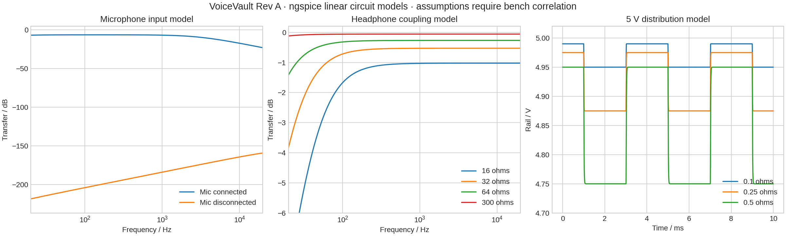
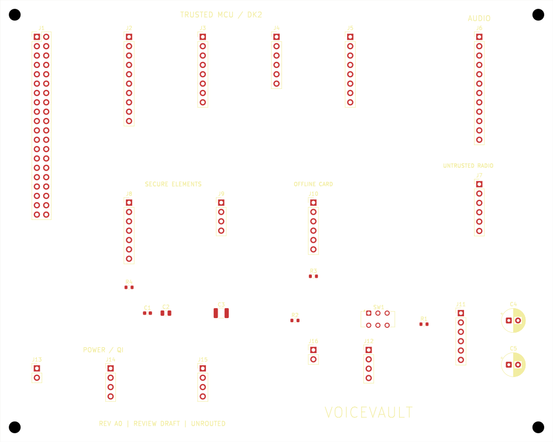
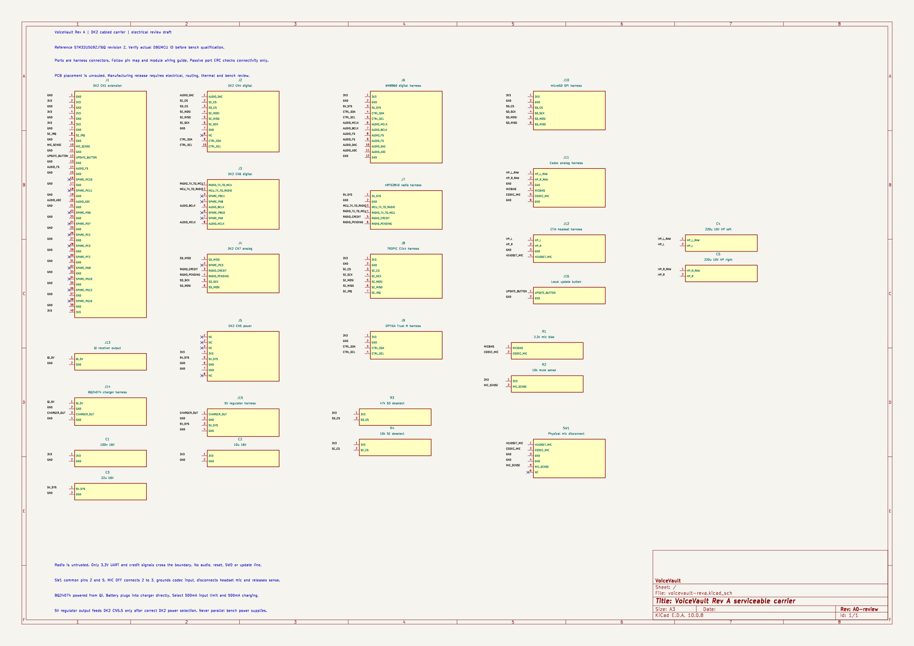

# Recorded hardware laboratory checks

The 2026-11-11 run checked the Rev A DK2 cabled carrier. Its overall hardware qualification status is **blocked**. The current published circuit files and native KiCad design reproduce the available checks through `./hardware/check`. The generator can rebuild the review-stage placement and overwrites its generated KiCad files.

- Native schematic ERC reports zero violations. The passive module ports check interconnections.
- Native PCB DRC reports 97 unrouted connections and zero other layout violations.
- The radio netlist has exactly the six declared connections. Electrical or information-flow isolation needs additional evidence.
- All 22 ngspice parameter cases meet their stated model bounds, including the modeled open mic switch and headphone DC blocking. Exact case inputs and logs are retained under `spice/`.
- Nine checker regression tests pass. These synthetic traces validate rejection behavior.
- The actual Renode CPU-only platform logs absent SAI2, GPDMA1 and GTZC1 when those addresses are read. That negative control passes because the missing behavior is detected.
- The actual QEMU MPS2 AN505 run completes the hybrid handshake and 32 audio frames. The image uses 863104 bytes of flash, 552324 bytes of static RAM including the 32 KiB heap arena, and 84876 bytes of observed stack against a 128 KiB reserve. This is CPU execution and sampled memory-use evidence.
- STM32U5G9 audio samples/DMA interrupt qualification and hardware CPU/DMA access denials remain blocked. The pinned target still has no qualified peripheral model or board measurement.

The independent voice laboratory's eleven-group suite was not rerun for this hardware-only design addition. Its earlier evidence retains its original source IDs and scope. No real VoiceVault hardware was built or exercised in this run. The NUCLEO-U5A5ZJ-Q proposal is documented separately and is awaiting a board-specific carrier design.

