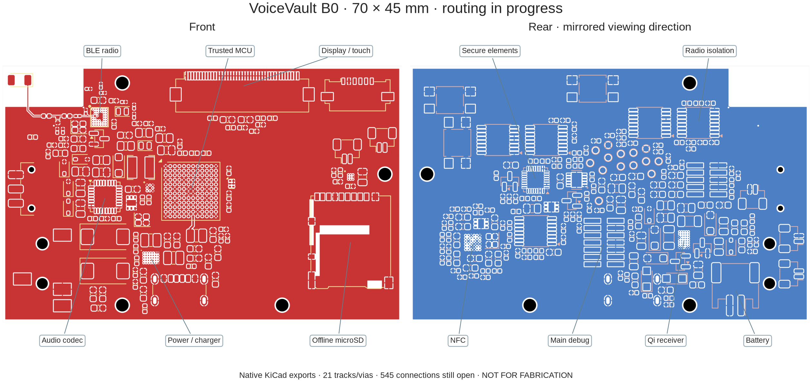
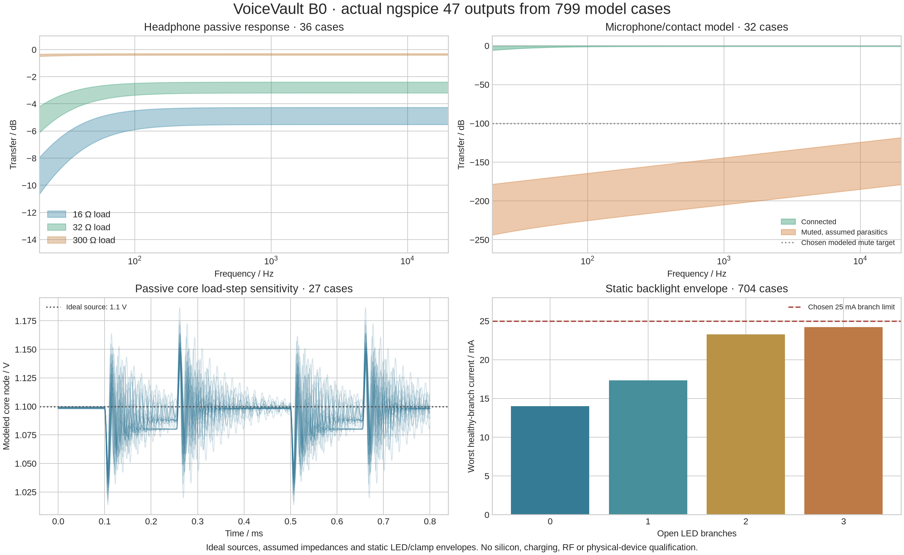

# VoiceVault B0 hardware evidence — 2026-11-12

**Available design/model checks passed. Manufacturing and physical qualification remain blocked.** No board was manufactured or measured. The Rust laboratory's eleven verification groups were not rerun for this CAD-only change.

The native board contains **296 electrical components, 14 probe pads and four mounting holes**, on a provisional two-sided 70 × 45 mm outline. The image labels actual footprint positions. It shows the accepted first RF/ground route and ground reference pours; most signal and power routing is incomplete. The six-layer/1.0mm stackup is a proposal, not an accepted manufacturing specification.

| Check | Recorded result | Evidence / scope |
|---|---|---|
| Source copies | Nine preserved references match their hashes | [Report](report.json) |
| MCU identity/pin mapping | 144 balls and 29 selected functions agree with pinned ST data | Actual native schematic export and [independent ST data](../../rev-b/reference/st-ufbga144-ballout.json) |
| Circuit-to-pad correspondence | 1,026 schematic-connected nodes, 124 intentional NC pins; 314 footprints | Actual PCB pad/net inspection, not just the circuit manifest |
| ERC | Zero issues | [Native ERC report](erc.rpt) |
| DRC | Zero non-routing violations; **545 unrouted connections** | [Native DRC report](drc.json). Its detailed unconnected list stops at 499; the full native ratsnest count is used for progress. |
| Antenna rule negative control | Unrelated track and ground via rejected; RF-feed track allowed | [Result](antenna-negative/result.json). A board copy was deliberately modified; the live PCB was unchanged. |
| Copper import guard | Valid existing-net RF connection retained, antenna intrusion rejected; live board unchanged | [Control result](routing/import-control.json), [reproducible check](../../tools/check_routing_import.py) |
| Local KiCad MCP | KiCad 10.0.8, 314 footprints, 199 named nets | [Actual stdio-to-IPC call result](mcp-connection.json) |
| ngspice 47 models | **799 cases completed** | Passive/static model assumptions below. |
| Power allocation | Named engineering modes fit the proposed 1200mAh-pack allocation under explicit assumptions | [Budget inputs/results and limitations](power-budget.json). Not measured power or battery life. |
| Historical routing trial | Incomplete, 480-second timeout; no accepted route | [Record](routing-study.json), [log](routing-study.log). Earlier copy, no output applied. Fanout progress is not routing completion. |

The accepted board contains **19 track segments, two ground vias and four ground pours**, alongside the tested antenna rule area. The full native count fell from 853 to 545; most of that reduction comes from ground pours. [Initial RF-stage record](routing/rf-stage.json), [accepted MCU connection](routing/core-route.json), [RF ground refinement](routing/rf-ground-refinement.json). A later bounded lattice-router study timed out with no saved route and was not applied: [record](routing/lattice-timeout.json), [log](routing/lattice.log).

[Manufacturing cost comparison](../../rev-b/MANUFACTURING_COST.md) targets four assemblies delivered to Sweden. Public fees establish cost drivers, not a cheapest complete delivered quotation.

Additional bounded Freerouting studies also timed out without an output session and were not applied: [360-second run](routing/freerouting-bounded.json), [240-second run with fanout disabled](routing/freerouting-no-fanout.json). The [local search-budget modification](routing/freerouting-budget-patch.json) is explicit; these were modified-tool experiments, not upstream qualification results. Fine-pitch escape and clock/decoupling placement need deliberate engineering before another whole-board routing attempt.

The [report](report.json) records SHA-256 hashes of the exact CAD, project/rule files and circuit manifest that were checked. All manufacturing blockers remain visible. Its `native_nets` count includes virtual singleton NC records; **199** is the count of named copper nets.

## Circuit-model measurements

- [27 MCU passive core-network cases](spice-core/summary.json): ideal averaged source, component sensitivities and a specified load step. No MCU regulator/control-loop model.
- [36 headphone, 32 microphone and 704 backlight cases](spice-audio-backlight/summary.json): exact measured model outputs, input assumptions and limits. No codec/charging/converter silicon or acoustic model.
- [Representative raw inputs, logs and data](sample-cases/) include the maximum-current and maximum-voltage backlight cases. The complete 799-case numerical summaries are retained above. Re-run the scripts to regenerate every raw case locally.
- [Simulator version](spice-audio-backlight/version.txt), [plot-library versions](plot-tools.json), [latest CAD/import check log](check.log), [799-case run before the final layout-only refinement](model-check-before-layout-refinement.log).

Reproduce available checks with `./hardware/check --design-only --spice`. The `--design-only` exit status concerns available checks; it does not clear the manufacturing verdict. Model results cannot establish that the device functions securely on physical silicon or withstands the adversary described in the software threat model.

## What remains

An accepted HDI stackup/pad process, reviewed exact parts and lifecycle/sourcing, completed power/RF/signal routing and planes, thermal/charging/ESD review, independent electrical review, final BOM/CPL/DFM/test-fixture acceptance, board-specific firmware and actual measured samples/interrupts/access denials. [Active design and gates](../../rev-b/README.md)
