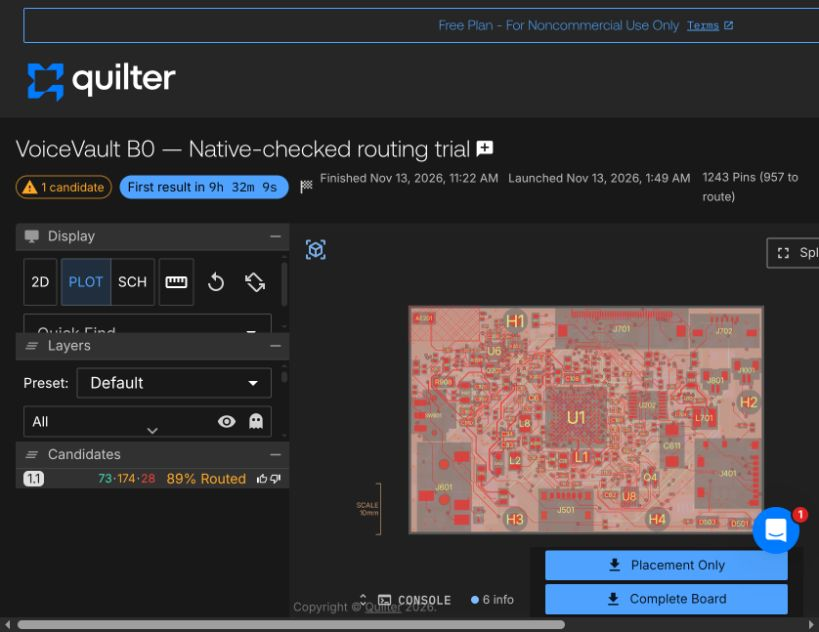

# Quilter candidate 1.1 — rejected for live acceptance

The full-routing job finished **13 November 2026 at 11:22 Europe/Stockholm**, after launching at 01:49. Quilter reported **89% routed**, not a complete board. Its review listed 73 successful physical-rule checks, 53 physical-rule warnings, 28 physical-rule errors and 121 design-rule failures. These cloud categories differ from native KiCad's checks and should not be added to native counts.

**Do not fabricate this board or copy its project settings over the live design.** This archive preserves an unsuccessful routing result for diagnosis. No returned copper has been accepted into the live editor.

## Native result

The raw returned board preserves the input's 314 components, 1,243 pads, pad/net assignments, poses, local manufacturing overrides, outline and all 473 protected copper items. The identity gate found an antenna-rule-area difference. Rather than adopting that normalization, the 6,885 additional copper items were transferred onto the trusted input, preserving its exact native antenna reservations, zones, project and rules.

After initialized native zone refill and DRC:

| Native measurement | Result |
|---|---:|
| Full unfinished connections | 103 |
| Layout errors | 294 |
| Warnings | 117 |
| Tracks / vias | 6,731 / 627 |
| Hole-to-copper clearance errors | 199 |
| Shorting-item errors | 39 |
| Copper clearance errors | 22 |
| Solder-mask bridge errors | 16 |
| Antenna-area/disallowed-item errors | 12 |
| Starved thermal errors | 6 |

Warnings comprise 105 dangling tracks and 12 dangling vias. The separate nominal laser-hole audit reports zero findings; that limited result does not override the native failures or establish a valid factory stackup.

The raw cloud `.kicad_pro` reduces some limits and disables microvias. It is preserved as evidence only. **The native result uses the original project/rules**, not those returned settings. In particular, the original 0.25 mm general hole-to-copper requirement and antenna restrictions were retained.

## Diagnosis and next repair

Native errors identify new through-vias overlapping rear-side components beneath the MCU, new tracks conflicting with other copper, insufficient drill-to-copper separation and tracks inside the reserved antenna region. Original checked input copper is preserved. Cloud completion percentage alone misses these acceptance failures.

A separate repair copy integrates the previously reviewed core/battery-capacitor and package-land corrections, then uses native DRC subjects to remove offending new cloud copper before a complete automated reroute. Original protected copper and native rules remain fixed. This is ongoing engineering work, not an accepted PCB or a manufacturing release.

[Downloaded files and hashes](download-manifest.json) · [Raw identity comparison](identity.json) · [Trusted reconstruction](native-reconstruction.json) · [Native summary and laser audit](native-summary.json) · [Full native DRC](native-drc.json).

The live KiCad board still contains the earlier failed FreeRouting checkpoint recorded in `hardware/rev-b/STATUS.json`. The new result must not be confused with that historical live state.
