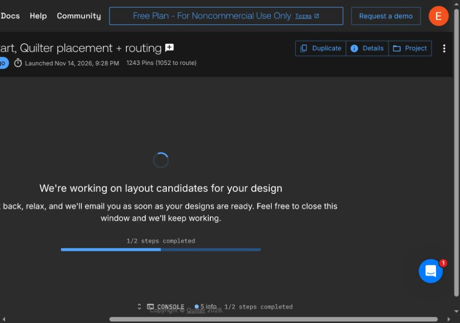

# Clean Quilter placement and routing experiment — 14 November 2026

**Submitted and running, not a finished PCB.** [VoiceVault B0 — Clean start, Quilter placement + routing](https://app.quilter.ai/jobs/6af8c1091a10ff2500b2ad4e) launched at **21:28 Europe/Stockholm** in Full layout mode on the free noncommercial account. Quilter explicitly says the browser can be closed and it will email when designs are ready. No payment, plan upgrade, order or manufacturing submission was made.

The owner requested a clean experiment using the already selected parts, with Quilter doing placement, chip fanout and routing. The earlier corrected job ended **Failed after 29h 27m 29s**, with no routed candidates. We did not cancel it. Its public console does not establish the cause; a human support diagnosis is pending. Previous copper or constraints could have obstructed it, but this is a hypothesis, not a diagnosed failure.

## What this input contains

| Item | Verified input |
|---|---|
| Circuit and parts | Same 314 footprints, including 296 electrical components, 14 test pads and four mounting holes; 1,243 physical pads |
| Connections | 1,026 connected schematic nodes and 124 intentional NC nodes match actual PCB pads |
| Existing routing | **Zero tracks, zero vias, zero copper pours**; all 7,165 previous track/via items and four pours removed from a separate copy |
| Placement | **292 components left outside the outline** for Quilter to place; only 22 connectors, switches, mounting holes and the chip antenna anchored |
| Chip fanout | Quilter's Generate Fanout enabled for U1, U3, U5, U6, U7, U9 and U10 |
| Construction study | 70 × 45 mm; six layers, ground references on layers 2 and 5; double-sided assembly; no dedicated power layer |
| New routing minimums | 0.10 mm width/clearance; 0.45/0.20 mm ordinary vias; 0.50 mm board margin; 0.30 mm component clearance |
| Circuit requirements | 30 current-budget rows, 115 decoupling relationships, five crystal groups, four switching-converter groups; GND primary |
| RF requirement | RAD_RF_50 at nominal 50 Ω; the UI fixes its impedance solver at **1 GHz**, not a qualified 2.4 GHz RF model |

All ordinary ICs, RF matching parts, clocks, passives, regulators and probe pads are movable. The complete selected circuit, reviewed package lands, numbered-pad nets, outline and explicit antenna reservations remain. The latest isolated package/C502 corrections are present because the source is the previously reviewed retry input; no new part substitutions were made for this run. This is not an approved assembly BOM.

[prepare_quilter_clean_start.py](../../../tools/prepare_quilter_clean_start.py) makes a copy and removes routing without writing the source or live CAD. A fresh native process reloaded the saved input, compared all components/pad geometry, checked fixed versus movable positions, and compared the independent KiCad schematic export against every connected/NC pin. A second generation using native deletion produced identical hashes for all 21 upload files. [Preparation and hashes](preparation.json).

The **[actual uploaded files](input/)** are frozen here. The server's **Download Input Files** archive was downloaded before launch: all **21 file hashes match** the independently checked clean input exactly. No earlier FreeRouting or locally generated escape copper is in this submission. [Server verification](server-verification.json).

Circuit requirements describe what the circuit needs; they contain no locally calculated trace coordinates or placement poses. Incorrect automatic current/decoupling guesses were replaced, and all five saved tables were downloaded again and compared field by field with the reviewed requirements. [Actual saved tables](constraints/) · [Verification and fixed-frequency limitation](constraint-verification.json). The automatically detected five crystal groups already matched. No automatic placement regions were generated; Quilter reported floorplanning optional and allowed the 292 unplaced parts to proceed.

## Backup and separation

Before preparation, a separate local backup preserved the entire hardware tree, hardware studies/caches and all Git refs. The live editor was saved and separately copied. The readable archive contains 30,469 entries and is 1,780,971,520 bytes; the Git bundle was verified and SHA-256 checksums were recorded. [Backup fingerprints and launch settings](launch.json). The large backup and private support transcript remain local under `Documents/VoiceVault-backups/2026-11-14-quilter-clean-start` and ignored lab artifacts; they are not uploaded to Quilter.

The live KiCad board remains the historical unfinished checkpoint. No competing local router is running, and no local fallback will be mixed into this cloud job. The earlier cancelled project was untouched. This is a new job in the separate VoiceVault routing project.

## What still needs qualification

Quilter needs an existing schematic, footprints, outline and constraints; it does not select or validate the entire device. Its [input guide](https://docs.quilter.ai/using-quilter/prepare-your-input-board-file) and [placement guide](https://docs.quilter.ai/guides/placement-guide) explain which inputs become fixed. The clean experiment removes prior copper and ordinary placement as potential obstructions. It is **not a controlled single-variable comparison**: placement freedom, fanout and routing dimensions also differ from the failed retry.

Fine-pitch packages may still require a via process the cloud router cannot generate. Its fanout is explicitly marked beta, especially for non-square pin grids. RF matching/antenna geometry, return paths, power loops, sourcing, exact stack/finish and assembly capability remain open. The cloud preset displays Lead-Free finish despite ENIG input metadata. No factory process is accepted by this study.

Quilter still warns of symbol/footprint pin-count differences and 18 board-only objects. Native correspondence passes for every electrical node; the reviewed extra connector MP lands and board-only holes/probes are retained. This does not waive inspection of the returned files.

A returned candidate must be checked for component/pad/net identity with **movable poses allowed**, exact mechanical anchors and antenna reservations, full native connectivity and original-rule refill/DRC. The older all-poses-fixed/copper-preservation gate is not directly applicable to this clean placement job. Do not bypass it by importing unchecked output: qualify a complete isolated candidate with the new placement freedoms, then review power, RF, clocks, analog and manufacturing geometry. No cloud completion percentage establishes a working or secure physical device.
