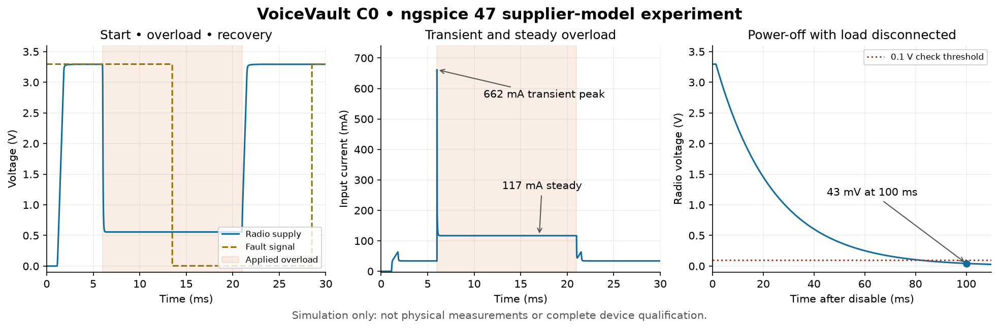

# Rev C clean Quilter input — 16 November 2026

The owner removed vibration and selected screen alerts. C0 now has **196 electrical components, 13 probe pads and four mounting holes: 213 footprints**, compared with B0's 296 electrical components and 314 footprints. That is **100 fewer electrical components, about 34%**. The previous [205-component snapshot](../rev-c/README.md) is preserved as historical evidence.

This is a checked input for a cloud layout study, **not a manufacturing release**. All 209 electrical/probe footprints remain unlocked and outside the outline in the native input; four existing mounting-hole geometries remain. There are **zero tracks, vias and copper pours**. No local router or electrical placement is mixed in. The earlier B0 live PCB and all cloud returns are preserved. A copy of the earlier C0 files and a hash manifest are also backed up under `Documents/VoiceVault-backups/2026-11-16-rev-c-before-quilter`.

## Observed native checks

| Check | Result |
|---|---|
| KiCad 10.0.8 ERC | Zero violations |
| Unplaced native DRC | Zero layout violations and zero schematic-parity findings |
| Functional schematic/native pad correspondence | 820 connected nodes matched |
| Independently specified critical pin connections | 62 passed; four corrupt-net negative controls rejected |
| Full native missing-connection count | **581, before layout**; the DRC JSON list truncates at 499 |
| PCB inventory | **213 footprints and 888 physical pad objects** |
| Antenna policy fixtures | Seven cases passed: baseline and valid front feed; wrong-net track, guard crossing, rear-layer feed, via and other component rejected |
| Simulator-result parser regression | Six tests passed, including exit-zero numerical abort and missing/non-finite measurements |
| ngspice 47 passive audio/backlight | 772 cases passed |
| Secure-bus RC model | 16 cases passed within stated capacitance/sink assumptions |
| Supplier radio-switch model | Startup, steady current limiting, fault, recovery and unloaded discharge passed |
| Main supplier converter model | **BLOCKED** — bounded CPU run and numerical timestep abort; no full-converter result |
| Full charging/MCU/NXP/RF/device qualification | **BLOCKED** |

[Full report](report.json) · [Raw ERC](erc.json) · [Raw DRC](drc.json) · [SPICE report](spice-summary.json) · [Antenna policy report](quilter-policy-report.json) · [Actual denied-item findings](antenna-negative-findings.json) · [Supplier source provenance](source-documents.json) · [Artifact hashes](artifact-sha256.json)

The antenna tests move sample components and inject test copper **only on isolated copies**, inside the outline, so the native rules are actually exercised. The real design remains unplaced and unrouted. These tests demonstrate rule enforcement, not RF tuning or correct interpretation by a cloud importer.

## Layout intent and cloud import

The input carries five broad top-side placement regions: antenna corner choices, charging connector along the bottom, headset on the right, microSD on the left and display connector near the top. They constrain intent without selecting exact component poses. The antenna has two footprint-attached rule areas that move with it, reserve a provisional 6.5 mm square, and leave a feed corridor. Native rules additionally restrict the corridor to the front-layer antenna feed. [Preparation tool](../../../tools/prepare_rev_c_quilter.py) · [Intent and reference lists](../../../rev-c/quilter-intent.json)

Quilter parsed the 18 native project/board/schematic files and reported **213 components, 209 to place and 888 physical pins**, matching native inventory. Its warning about schematic/board pin-count differences was investigated: the four component pin-set differences are the extra unconnected **MP mechanical anchor pads** on J502, J503, J701 and J702. All functional pin maps are checked separately. The separate four-components-missing information concerns **H1–H4**, which are mechanical mounting holes.

The current floorplanner exposes the five on-board regions for manual component association. The eight off-board grouping regions are not exposed there, and automatic grouping reported no unassigned component groups. Do not claim those grouping hints were applied. The remaining electronics stay available for Quilter's own placement. Circuit comprehension, returned bypass/clock/power-loop checks and native review remain necessary.

The selected cloud study uses **JLCPCB six layers, 4 mil trace/clearance, ordinary 0.45/0.20 mm through-vias, 0.50 mm board margin and both assembly sides**. Layers 2 and 5 are ground references; four layers remain for signal/power routing. There is no dedicated power-plane layer. The preset's modeled total is **1.538 mm (nominal 1.6 mm)**; the earlier native input's 1.0 mm was provisional. Match the returned native stack and impedance geometry to the effective cloud settings before acceptance. This is a provisional process choice, not a fabrication quote or proof of cheapest landed cost.

[Separate Rev C project](https://app.quilter.ai/projects/6afa5243b7dacfb3b3442460) · [New job](https://app.quilter.ai/jobs/6afa5243b7dacfb3b3442461)

**Historical pre-final-input snapshot.** The corrected final input and launched replacement job are recorded in [quilter-launch](../quilter-launch/README.md). No old Quilter job has been changed, and no purchase, paid service or manufacturing order has been submitted.

## Simulation scope and reproduction



The modeled radio overload settles near **117 mA** after an initial transient of about **662 mA**. The output recovers, then falls to about **43 mV after 100 ms** of unloaded passive discharge. This is not an instantaneous current clamp or proof of main-rail fault isolation. Passive/static models and separate datasheet arithmetic do not replace physical power, thermal, audio or RF measurements. The costly converter failure logs remain preserved diagnostic evidence and are not rerun by the routine checker.

From the repository root:

```sh
python3 hardware/tools/fetch_rev_c_references.py
./hardware/check --rev-c --design-only --spice
python3 hardware/tools/record_rev_c_evidence.py --destination /absolute/path/to/a/new/evidence-directory
```

Use KiCad's bundled Python for `prepare_rev_c_quilter.py` after generating a disposable unplaced C0 copy. It refuses routed/poured input and verifies that adding constraints leaves every component pose, value, pad net and pad geometry unchanged. Do not regenerate or overwrite a returned layout. Exact battery/holder and charging policy, complete power stability/thermal analysis, real NXP/MCU drivers and provisioning, debug lifecycle, trusted UI, radio/audio isolation and acoustic qualification remain release gates. [Current circuit status](../../../rev-c/README.md).
