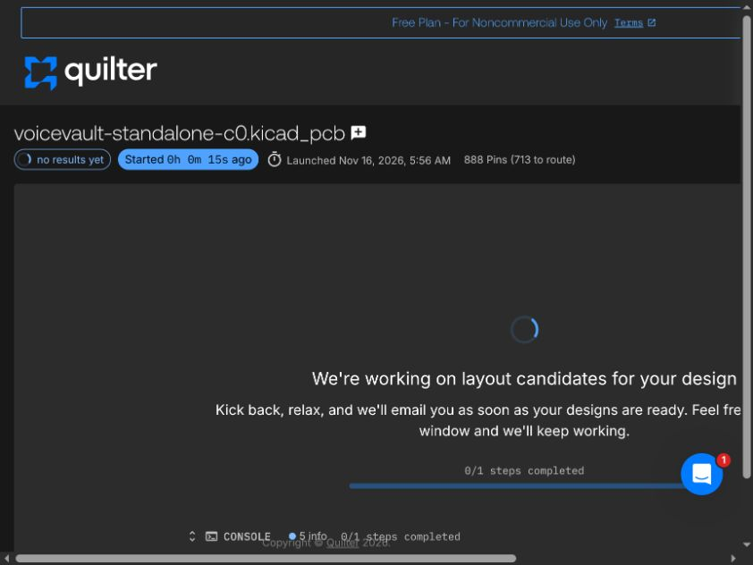

# VoiceVault C0 — Quilter run started

**Started 16 November 2026, 05:56 CET.** The new full-layout job has been accepted in the cloud. Quilter states that the window can close and work will continue; it will email when candidates are ready. Completion by morning is not guaranteed.

[Running full-layout job](https://app.quilter.ai/jobs/6afa892f82651a6067c78f22) · [Project](https://app.quilter.ai/projects/6afa5243b7dacfb3b3442460) · [Recorded settings/status](job.json) · [Server input hash verification](server-input-verification.json)

The owner removed vibration. The input contains **196 electrical components, 13 probe pads and four mounting holes: 213 footprints**—100 fewer electrical components than B0. All 209 electrical/probe footprints are unplaced in the native input; existing routes, vias and pours are zero. Quilter does the physical placement and routing. All earlier B0 work and drafts are preserved.

All **18 files downloaded back from the server exactly match the corrected local source**. The antenna network was corrected to the Johanson reference starting topology: series C212, shunt L202, series L203. This remains an RF tuning starting point, not proof of hardware performance.

Fresh KiCad 10.0.8 CLI checks found **zero ERC violations and zero unplaced-layout DRC violations**. Host read-only parsing verifies **72 critical pin/net assignments** and **705 functional pin nets**, among **820 total exported nodes**. The prior total-node count must not be read as a count of only functional connected pins. [Actual input report](report.json) · [Raw ERC](erc.json) · [Raw DRC](drc.json).

Reviewed cloud configuration: six-layer JLCPCB 4 mil preset; layers 2/5 ground; ordinary 0.45/0.20 mm through-vias; 0.50 mm margin; both assembly sides permitted; **85 bypass assignments, 14 current budgets, three switching-power loops, four crystals and one 50-ohm net**. Forced beta BGA fanout is off. [Uploaded CSV settings](uploaded-settings/). Current budgets are provisional routing allocations, not measured consumption or battery approval. The RF frequency literal imported as 1 GHz in the UI, so this records the effective model limit rather than claiming 2.4 GHz qualification.

The five native on-board connector/antenna regions were associated. The eight off-board grouping hints were not exposed by the floorplanner; its automatic grouping found no unassigned groups. Remaining electronics are available to Quilter's placer. KiCad custom rule parsing is unsupported; validate preservation of footprint-attached antenna keepouts and net/layer restrictions on every returned candidate. The selected cloud preset is 1.538 mm modeled total, nominal 1.6 mm; reconcile it with the earlier provisional 1.0 mm native input before fabrication.

A local setup rerun crashed in KiCad's bundled Python 3.14. Replacing existing native rule-area objects through that path is now disabled; the final corrected input was checked with host parsing and native C++ CLI instead. [Crash record and scope](local-crash.json). This identifies the crashing process, not a proven upstream Python defect.

Earlier [scoped simulations and antenna-policy tests](../quilter-input/README.md) remain evidence for their stated assumptions, not a newly executed whole-device verdict. The main converter model, full charging/thermal/RF analysis, exact battery/holder, real MCU/NXP drivers and provisioning, trusted UI/audio/DMA, radio isolation and acoustic qualification remain open. No manufacturing-ready claim, order, payment, paid service or fabrication submission has been made. Returned copper must pass complete native connectivity, DRC, circuit and mechanical review before acceptance.
