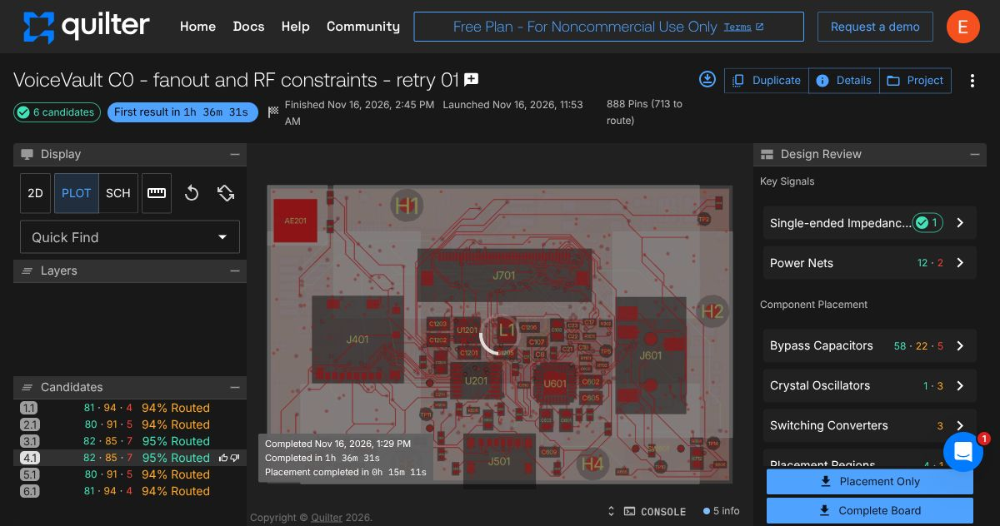

# Corrected C0 run: completed, not accepted

[Quilter retry 01](https://app.quilter.ai/jobs/6afadd5b82651a6067c78f92) finished at **14:45 CET on 16 November 2026**, approximately 2h52m after launch. Its best candidates reached **95% routing**, with 25 incomplete nets, 26 dimension findings, two padstack findings, 32 physics warnings and seven physics errors reported by Quilter. A higher routing percentage has not produced an acceptable PCB.

## Native return checks

Two different exports were checked with **KiCad 10.0.8**, separately from the live editor. Copper zones were refilled in memory before the final checks. No tracks or components were moved, deleted or rerouted. Raw downloaded CAD is preserved under the ignored run archive and in Downloads.

| Native result after refill | Candidate 4.1, 95% | Candidate 1.1, 94% |
|---|---:|---:|
| Missing connections | **30** | **32** |
| Short-circuit findings | **29** | **27** |
| Copper-clearance findings | 7 | 15 |
| Hole-clearance findings | 29 | 17 |
| Dangling tracks | 20 | 26 |
| Solder-mask bridges | 9 | 8 |
| Antenna forbidden-track findings | 4 | 4 |
| Antenna/library mismatch | 1 | 1 |
| Silkscreen findings | 49 | 45 |

These are checker findings, not a claim of independent physical faults for every row. The native input's 0.20 mm hole-to-copper policy was retained. Candidate 4.1 was also checked with Quilter's own returned project limits: **28 short-circuit findings and 30 missing connections remain after refill**. The major failures therefore cannot be dismissed as an overly conservative local clearance rule or stale zone fills.

All **213 footprint values and pad-net assignments**, plus the four mounting-hole coordinates, match the checked input. The electrical source circuit remains intact. The failures concern returned copper and layout constraints; neither candidate was imported into the live board.

The native reports identify shorts involving the processor fanout and nearby opposite-side components. For example, a GND through-via at approximately **(65.408287, 48.971400) mm** intersects C107 pad 1, assigned to **MCU_VDD11**, on the front surface. [Actual native finding](example-short.json). The underlying interaction between fanout generation, placement and export requires investigation; a specific internal Quilter defect has not been proven.

An independent run from the portable support packet reproduced **30 opens and 36 copper short/clearance findings**, including 27 labeled shorts and nine labeled clearance failures. The earlier input-profile snapshot labels these 29 shorts plus seven clearance failures; the returned profile labels them 28 plus eight. The classification count varies across native loads, while all three checks reject the same copper and retain 30 opens. Preserve the complete reports rather than treating an exact short count as a stable fingerprint. [Portable reproduction check](support-packet-check.json).

The antenna was moved from front to back. Its footprint-attached `VV_ANTENNA_OTHER_LAYERS` exclusion still lists **B.Cu plus all inner layers**, instead of swapping B.Cu to F.Cu with the footprint. Native KiCad consequently rejects the B.Cu feed and reports a footprint/library mismatch. This provides a reproducible constraint-preservation problem for Quilter to investigate. A possible future workaround is a layer-symmetric internal-layer exclusion plus a separate same-side acceptance check; it has not been substituted into this run or validated as a new layout.

[Checked summary and CAD hashes](review.json) · [Candidate 4.1 original-policy DRC](candidate-4-native-refilled.json) · [Candidate 4.1 returned-profile DRC](candidate-4-cloud-refilled.json) · [Candidate 1.1 original-policy DRC](candidate-1-native-refilled.json) · [Checked input and original retry rationale](../quilter-retry-01/README.md)

*The service's 95% routing indicator is not native acceptance; the electrical findings above block release.*

## Next action

Prepare a reproducible support packet for the new fanout/export findings, obtain Quilter's engineering guidance, and correct the constraint/input handling before another layout attempt. The earlier support conversation concerned the stalled B0 job; sending this new report needs the owner's specific authorization. A draft is supplied in [SUPPORT_REPORT.md](SUPPORT_REPORT.md). No new message has been sent by this review.

Keep all actual component placement and routing with Quilter. Do not launch an identical job, erase evidence, import unqualified copper, relax checks to obtain a pass, or submit this board to manufacture. A larger prototype or a different manufacturable escape strategy may be evaluated after the returned-layout problem is understood; extra layers alone do not repair shorts or a failed keepout transformation.

No purchases, orders or fabrication submissions were made. Battery/charging safety, RF behavior, MCU/audio DMA, secure-element integration and the other hardware release gates remain open.
