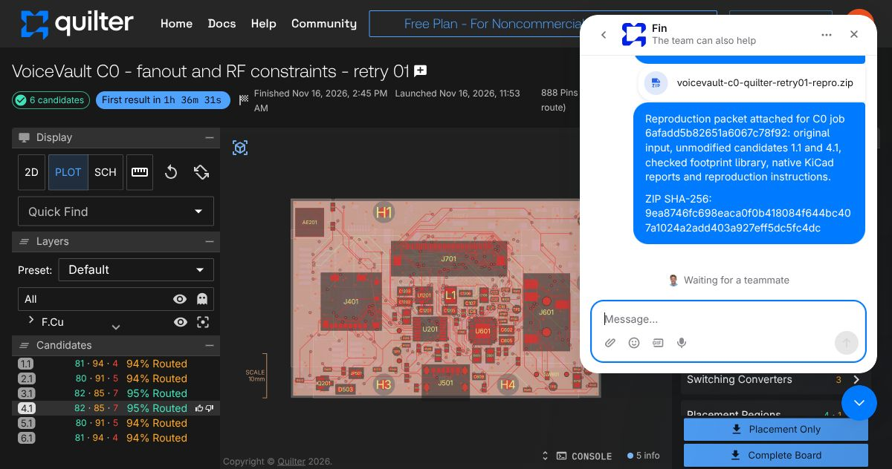

# Quilter report and CAD packet sent

The owner explicitly authorized sending the new report on **16 November 2026**. The full report and reproduction ZIP were posted through Quilter's Intercom support messenger in the existing **Job failure escalation** conversation. The message identifies the completed C0 job separately from the older stalled B0 job.

Both new user messages were observed in the conversation, including the downloadable `voicevault-c0-quilter-retry01-repro.zip` attachment. Delivery was recorded at **15:06 UTC / 16:06 CET**. This records successful posting, not a claim that an engineer has opened or reviewed the files.

The report requests a human engineer's diagnosis of the native shorts/fanout/export interaction and antenna keepout layer transformation, a supported input/configuration change, and an email reply to the account holder. No paid support, upgrade, new routing run or manufacturing submission was authorized.

The messenger still displayed **Waiting for a teammate**; no new human response was observed. The exact submitted text, attachment caption, archive checksum and posting receipt are preserved here. The uploaded archive remains byte-identical to the independently checked packet.

[Submitted report text](message.txt) · [Attachment caption](attachment-message.txt) · [Receipt](receipt.json) · [Native return diagnosis](../quilter-retry-01-return/README.md)

