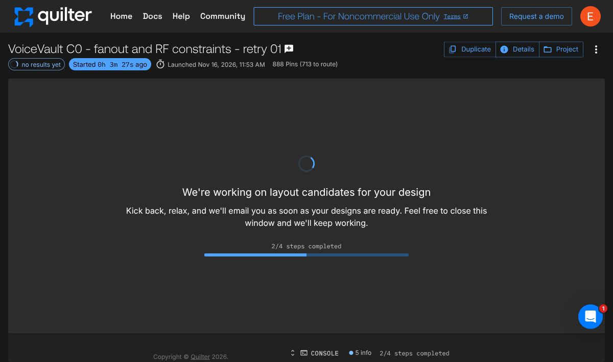

# Rev C return review and corrected Quilter retry

**The first C0 return is incomplete and has not been accepted into the live board.** A separate corrected full-layout run was observed started at **11:53 CET on 16 November 2026**: [VoiceVault C0 — fanout and RF constraints — retry 01](https://app.quilter.ai/jobs/6afadd5b82651a6067c78f92). The [first job](https://app.quilter.ai/jobs/6afa892f82651a6067c78f22), input and all earlier results remain preserved. No purchase or manufacturing submission was made.

*Captured 3m27s after launch: no results yet, with two of four setup/computation steps complete. This progress indicator is not a routing-completion percentage.*

## What the first result actually contains

Quilter finished the first C0 job at 08:04 CET after approximately 2h08m, producing six candidates. The best two, 2.1 and 3.1, both report **93% routing** and contain **identical PCB bytes**. They are one layout, not independent improvements.

| Check | Observed result |
|---|---|
| Quilter routing warnings | 34 incomplete nets and two padstack-collision findings |
| Native KiCad connectivity | **40 missing connections across 34 nets**; 37 missing connections touch U1 |
| Native check with returned project limits plus original RF rules | Nine RF-rule findings and 43 silkscreen findings |
| Native check with original 0.25 mm hole-to-copper limit | An additional 199 hole-clearance findings |
| Component values and all pad nets | Preserved against the clean source inventory |
| H1–H4 mounting-hole locations | Preserved |
| Quilter physics checks | 16 bypass, three crystal, three converter, one impedance and one placement-region checks failed |

The two Quilter padstack findings were not reproduced as copper-clearance failures by native KiCad under the returned profile. They still require investigation; neither checker replaces the other. Two of the native RF findings concern whole-zone outlines, whose intersection with a cutout does not itself prove filled copper enters that cutout. Actual feed routing also violates the intended restriction: the returned antenna is on B.Cu and its feed traverses B.Cu and In3.Cu. Matching parts are spread across faces and far from the antenna.

See [diagnosis](diagnosis.json), [original-rule DRC](drc-original.json), [cloud-profile DRC with original RF rules](drc-cloud-rules.json) and [download hashes](returned-artifacts.json). Raw returned CAD and ZIPs are preserved in the local run archive and Downloads; they are not substituted for the native source.

## What changed for the retry

The [separate retry input](../../../rev-c/quilter-retry-01/README.md) keeps the same **196 electrical components and 213 total footprints**. All electrical components remain unlocked and parked outside the outline. It contains no tracks, vias or copper pours. No local placement, manual routes or FreeRouting result enters this run.

1. **Enable Quilter's automatic U1 BGA fanout.** The previous attempt had this option disabled. The concentration of opens at U1 makes this the first correction to evaluate; it does not guarantee all pins will escape.
2. **Make the antenna's same-side feed restriction geometric.** A third footprint-attached keepout blocks all tracks on the opposite surface and every internal layer. It accompanies the existing no-pour/no-via exclusion and C-shaped feed corridor. Geometry follows the antenna pose; returned layer handling must still be checked. The same-side surface can be front or back, with its corresponding ground reference. This replaces the original global front-only policy.
3. **Add nine explicit proximity requirements.** Five bind the RF matching chain to the radio/antenna, three keep feedback resistors close to their controllers, and one keeps the USB TVS near the fused input. These are Quilter best-effort constraints with reported pass/fail outcomes, not hard proof of acceptable RF or power layout.
4. **Retain the reviewed circuit settings.** There are 85 bypass entries, 14 current budgets, three converter loops, four crystals, one primary ground and one 50-ohm net. All 85 downloaded bypass entries exactly match the reviewed CSV. The duplicate workflow failed to copy the converter definitions; all three were explicitly restored and verified before launch.
5. **Use an explicit native 0.20 mm hole-to-copper study limit.** The original local limit was 0.25 mm; Quilter's returned project uses 0.1016 mm. The retry records the [published JLCPCB via-hole-to-copper/track minimum](https://jlcpcb.com/capabilities/pcb-capabilities) rather than silently inheriting the returned rule. This is not a complete manufacturing rule set; distinct PTH and other manufacturing requirements still need review.

The selected cloud stack remains six layers, S/GND/S/S/GND/S, 1.538 mm modeled total, ordinary 0.45/0.20 mm vias, 4 mil trace/space and 0.50 mm board margin. Both assembly faces remain available. No dedicated power plane, HDI or paid option was added. The earlier input thickness of 1.0 mm remains a provisional inventory setting, not the effective cloud stack. Impedance is modeled by Quilter at 1 GHz; no 2.4 GHz RF validation is claimed.

## Verification and remaining gates

The native retry input has **zero DRC layout findings**, preserves every original component pose/value/pad/net and all 16 schematic files byte-for-byte, and passes 72 critical pin/net checks. Five isolated native CLI controls demonstrate that the same-side corridor is allowed and the opposite-side feed, inner-layer feed, wrong-net track and out-of-corridor track are rejected. [Results](retry-checks.json) · [Input DRC](retry-input-drc.json). These are tests of constraints on isolated copies, not routes inserted into the submitted design.

All **18 downloaded server input files byte-match the checked local retry**. [Hash-bound verification](server-input-verification.json). Preparation and checks use host text parsing and KiCad's C++ command line; they do not rerun the Python 3.14 rule-area replacement path that crashed earlier.

The parser warning was traced to mounting-pad identifier `MP` on four connectors (J701, J502, J503, J702), absent from their schematic symbols; functional pad numbers match. H1–H4 are mechanical-only anchors, explaining the separate missing-schematic-component notice. The no-power-layer notice is informational: current-sized traces are used and two reference ground layers are retained.

**Release remains blocked.** Recheck new returned connectivity, library geometry, antenna keepouts and layer transforms, physical RF matching/return paths, decoupling, clocks, converter loops, stack and original/native rules. A 100% connectivity result alone would still not qualify battery safety, charging/thermal behavior, RF performance, acoustic leakage, MCU/audio DMA, secure-element provisioning or the complete device.
