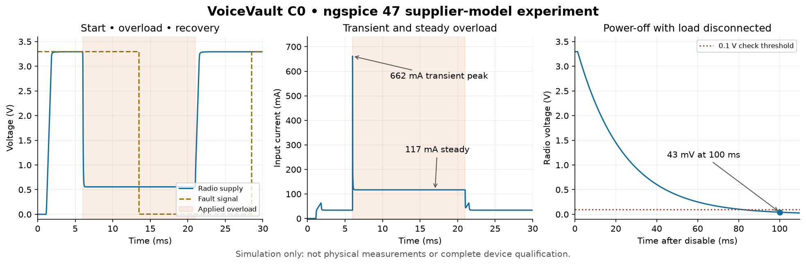

# C0 circuit checks — 16 November 2026

This snapshot covers the separate, completely unplaced Rev C circuit draft. **No physical board, final layout, full-device simulation or manufacturing qualification is claimed.** The native tool versions are KiCad 10.0.8 and ngspice 47.

| Observed check | Result |
|---|---|
| Native schematic inventory | 205 electrical components + 13 probes |
| Native PCB inventory | 222 footprints including four mounting holes |
| Independent critical connections | 62 passed; four corrupt-net negative controls rejected |
| Schematic/native-pad correspondence | 845 connected nodes matched |
| KiCad ERC | Zero violations |
| Unplaced native DRC | Zero layout violations; zero schematic-parity findings |
| Full native missing-connection count | **603 — unplaced and unrouted input** |
| PCB tracks, vias and copper pours | Zero; all electrical/probe footprints unlocked and unplaced |
| Passive audio/backlight models | 772 cases passed |
| Secure-bus RC sensitivity | 16 cases passed; assumed capacitance 20–200 pF; worst rise about 804 ns |
| Supplier Boolean-model port | 12 independently expected logic outputs matched |
| Simulator-result regression | Six tests passed, including exit-zero abort and missing/non-finite measurements |
| Supplier radio-switch experiment | Startup, overload, fault, recovery and unloaded discharge checks passed |
| Supplier main-regulator model | **BLOCKED — CPU budget and numerical timestep abort** |
| Complete power/charging/hardware qualification | **BLOCKED** |

[Full report](report.json) · [SPICE report](spice-summary.json) · [Raw native ERC](erc.json) · [Raw native DRC](drc.json) · [Artifact hashes](artifact-sha256.json)

[Result-parser regression log](spice-result-regression.log) · [Regression tests](../../../tests/test_spice_results.py)

The DRC JSON's unconnected list stops at 499 entries. The full native connectivity count is 603; neither count is a completed-routing claim. Checking the unplaced inventory detects package/connection issues but says little about future routing clearance or signal integrity.

## Radio supply experiment



The supply is approximately 3.293 V before overload. In the steady overload window it draws about 117 mA and asserts the fault signal. The initial overload transient reaches approximately **662 mA** before settling; the steady limit must not be mistaken for an instantaneous peak limit. It recovers when the overload ends. With the nominal radio load disconnected at disable, the passive discharge leaves about 43 mV after 100 ms. Main-rail coupling, temperature, backfeed, RF and physical malicious-load behavior remain unqualified.

The supplier PSpice model uses Boolean XOR syntax that ngspice interprets as exponentiation. The narrow port changes that comparator expression to explicit Boolean inequality, preserves the original supplier file and records both hashes. A separate 12-output truth-table check precedes the transient run. This is a simulator-language compatibility correction, not a new semiconductor model.

[Transient input](spice-radio-switch-input.cir) · [Actual transient log](spice-radio-switch-ngspice.log) · [Logic preflight input](spice-model-logic-input.cir) · [Actual logic log](spice-model-logic-ngspice.log) · [Port implementation](../../../tools/spice_model_port.py)

## Unresolved converter result

A 3 ms supplier buck-boost experiment exceeded its bounded CPU budget. A shorter experiment returned process exit code zero but its log says **“Timestep too small”** and **“simulation(s) aborted.”** It is blocked, never a pass. [Bounded-run record](converter-execution.json) · [Short-run record](converter-execution-short.json) · [Actual abort log](converter-ngspice-short.log)

The secure-bus experiment uses an ideal switch with a conservative assumed sink resistance. Audio/backlight cases use ideal/static networks. Feedback, undervoltage, charger-current/timer, current-limit and audio-dropout estimates are separately marked arithmetic in the report. No MCU DMA, NXP RNG, battery chemistry, full charger loop or thermal model was run.

## Reproduction and remaining gates

From the repository root:

```sh
python3 hardware/tools/fetch_rev_c_references.py
./hardware/check --rev-c --design-only --spice
python3 hardware/tools/record_rev_c_evidence.py
```

The final plotting step additionally needs NumPy and Matplotlib. The checker retains raw files in `.lab-runs/hardware/standalone-c0/`; supplier originals are hash-pinned and stay in the ignored cache. [Supplier references](../../../rev-c/references.json). The historical converter-failure logs are preserved diagnostic evidence; the routine check does not repeat that costly failed experiment.

Before layout: RF/connector/mechanical constraints, power-loop/return requirements and remaining fine-pitch escape feasibility. All electrical placement and routing is reserved for Quilter. Before physical reliance: exact pack/holder and charging policy, full power stability/thermal/fault work, NXP provisioning/driver/persistence, MCU peripherals, trusted UI, radio/audio/isolation and acoustic qualification. [Current circuit status](../../../rev-c/README.md).
