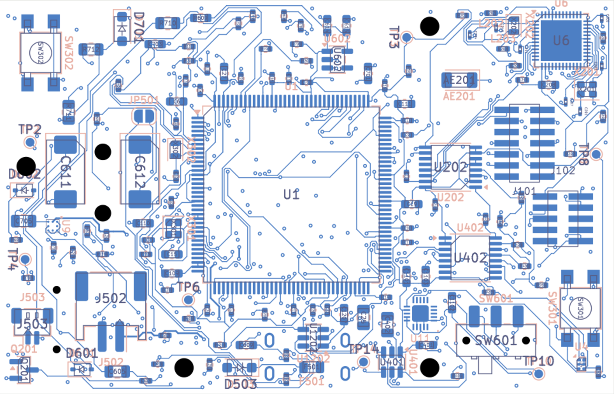
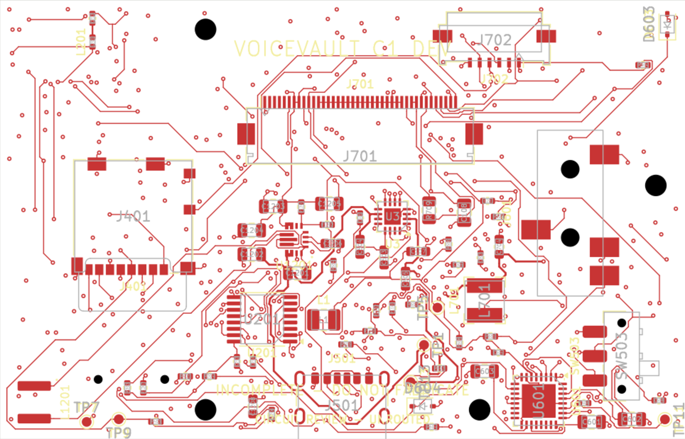

# C1 returned layout: six connections remain

**Reviewed 17 November 2026. Candidate 3.1 is not accepted for manufacture.** The [C1 full-layout job](https://app.quilter.ai/jobs/6afb49addfae511781423d99?candidate=3) finished on **16 November at 21:19 Europe/Stockholm**, after approximately **1 h 37 min**. All six cloud candidates report **98% routing**, versus the previous BGA attempt's 95%. Candidates 3.1/5.1 have the best displayed placement-check score: 105 successful PRC checks, 19 PRC warnings and no PRC errors. This review independently checks **3.1**, not every candidate.

The LQFP return is a substantial improvement: native KiCad confirms **six missing connections and zero copper shorts**. It still contains functional, hole-clearance, antenna and placement issues. Routing percentage does not qualify a complete device.

## Native KiCad findings

Using KiCad **10.0.8**, zone refill and explicit schematic parity:

| Check | Observed result |
|---|---|
| Full native unconnected count | **6**, matching the complete DRC list |
| Copper shorts / copper-clearance findings | **0 / 0** |
| Schematic parity | **0 mismatches** |
| Components, values, pad-net assignments | All **216 footprints** and every original value/net preserved |
| Mechanical mounting positions | H1–H4 preserved |
| Critical circuit / hostile-radio boundary checks | **72 pass** |
| Copper | 4,571 track segments, 470 vias, two ground pours, six copper layers |
| Original-profile findings | **21 errors**: 15 antenna-rule findings and six hole-clearance findings; **49 warnings**: 48 silkscreen plus one antenna-library mismatch |
| Returned-profile findings | Six hole-clearance findings disappear under its looser rule; the 15 antenna-rule findings and 49 warnings remain |

[Machine-readable review](report.json) · [Original-profile DRC](original-profile-drc.json) · [Returned-profile DRC](returned-profile-drc.json) · [Identity check](identity.json).

### The six unfinished connections

| Net | Function | Missing connection identified by native DRC |
|---|---|---|
| LINK_TX | MCU-to-radio transport transmit | MCU U1 pin 38 to interface U201 pin 3 |
| LINK_RX | Radio-to-MCU transport receive | Existing route to U201 pin 4 |
| SE_SDA | Secure-element data bus | Existing route to U11 pin 9 |
| AUD_RESET_N | Audio codec reset control | Existing route to U601 pin 31 |
| BL_FB | Backlight regulation feedback | Existing route to U9 pin B3 |
| BACKLIGHT_PWM | Trusted backlight control | Existing route to U9 pin A2 |

All six need completion for correct device operation. These are six actual missing connections in this candidate, not a claim that the entire physical device is only six tasks from qualification.

### Hole-clearance rules differ

The original input requires **0.20 mm** hole-to-copper clearance. Six returned trace segments lie **0.1136–0.1811 mm** from unplated holes on H3, SW503 and J601. The exported Quilter project instead uses **0.1016 mm**, so those findings disappear with that profile. Both reports use the same untouched board, footprint library, antenna rules, schematics and zone-refill/parity command; only the project settings differ.

No source constraint was relaxed. Correct the geometry against the intended fabrication requirements rather than treating the exported rule change as approval. These remain provisional design limits, not a complete manufacturing acceptance rule set.

### Antenna findings require more than a layer-label fix

AE201 was placed on **B.Cu** despite the front-side region intent. Its attached `VV_ANTENNA_OTHER_LAYERS` keepout still lists **B.Cu**, where it should list F.Cu for a back-side antenna. This reproduces the earlier outer-layer transformation issue and generates three findings against its own feed.

Separately, **two MCU_NRST segments on Layer 3 and two MCU_SWO segments on Layer 4 enter the antenna's recorded keepout**. Overlapping geometric/custom rules produce multiple findings for each segment, so the 15 findings are not 15 distinct traces. Fixing only the outer-layer membership would leave those four reset/debug segments to reroute. The antenna's intended placement and actual RF return geometry also need review.

The cloud reports two padstack collisions and six incomplete nets. Those cloud categories are not interchangeable with KiCad's independent finding categories. Its placement review also fails seven bypass-capacitor checks, two crystal checks, all three converter-loop checks, two region checks and five proximity checks. Some may be conservative or best-effort checks, but they must be investigated; this review does not dismiss them because routing improved.

## Actual returned board views

These are native KiCad exports of the downloaded candidate, not an artist's impression or a manufacturing release. The LQFP144 MCU is the large central perimeter-leaded footprint on the back.



[Back vector view](back.svg)



[Front vector view](front.svg)

## Preservation and next work

The original download and both native-check work folders remain under `.lab-runs/hardware/quilter/2026-11-17-c1-review/candidate-3/`. The ZIP SHA256 is `a33d6175679915ba5f36ff01a28390cc3ee3a27aee806d55a063f031e8dfb2c7`; raw PCB SHA256 is `9dd8b00cb72809a7b252615c985ae6f2feabc22705ff30dd6830d22630637d96`. The raw return, all 18 launched C1 CAD files and the live B0 board remain unchanged. No local routing, live import, cloud restart, purchase or manufacturing submission occurred.

The next engineering step is a targeted routing/constraint correction: complete the six functional gaps, keep traces clear of the holes and antenna exclusion, correct/verify the antenna layer transformation, then investigate the failed power-loop, clock, bypass and placement checks. Quilter remains responsible for C1 placement/routing. Re-run full native refill/DRC/parity and preservation checks before any acceptance. Actual power/RF/audio/security and assembly qualification remain later gates.

The original-profile command was:

```bash
flatpak run --user \
  --env=KICAD_CONFIG_HOME=/home/erikclean/src/secure-voice-lab/.lab-cache/kicad-revc-checks \
  --command=kicad-cli org.kicad.KiCad pcb drc \
  --refill-zones --schematic-parity --format json \
  --output .lab-runs/hardware/quilter/2026-11-17-c1-review/candidate-3/original-profile/drc.json \
  .lab-runs/hardware/quilter/2026-11-17-c1-review/candidate-3/original-profile/voicevault-standalone-c1.kicad_pcb
```

The independent full ratsnest count came from the read-only native `inspect_rev_c.py` tool on the raw return. No native Python rule-area replacement was used.
