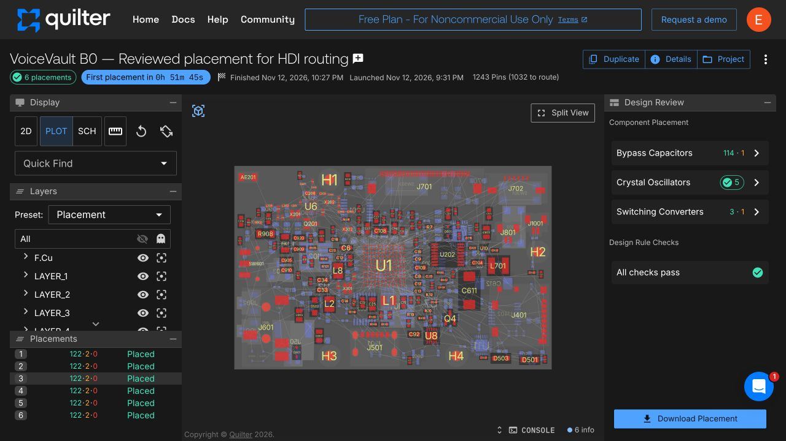
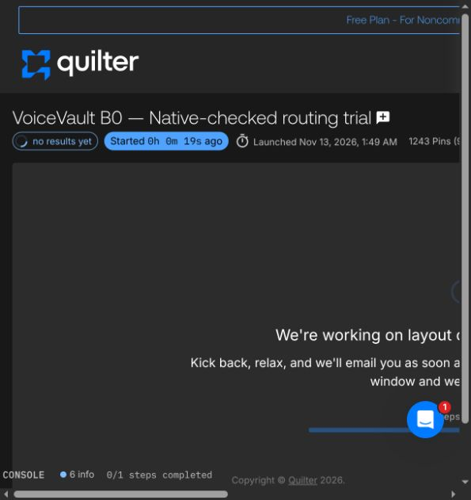

# Quilter routing preparation — 13 November 2026

**Placement completed; full routing and manufacturing qualification remain incomplete.** The live KiCad board still contains the earlier unfinished FreeRouting checkpoint. The new cloud candidates are isolated copies, not an accepted replacement.

## Separate new project

The owner requested an independently configured [new VoiceVault project](https://app.quilter.ai/projects/6af617fb05fb406688265ff7). The cancelled project and its guessed settings were not reused or modified. The free account was used; no purchase, upgrade, manufacturing order or supplier message was made.

[The placement-only job](https://app.quilter.ai/jobs/6af61bb61a10ff2500b2aac8) finished on 12 November at 22:27 Europe/Stockholm and produced six placements. This is not a completed routing run. All six were downloaded and checked with native KiCad. Each retained all 314 footprints, 1,243 pads, numbered pad/net assignments and 65 fixed anchors; 249 flexible components moved. Sensitive RF/clock/switch-node copper and the antenna reservations were retained. Quilter's summary reported 122 successful physical-rule checks, two warning groups and no cloud DRC errors per placement.

## Independently selected provisional construction

The new configuration uses six copper layers with ground-reference layers 2 and 5, signals on the other four layers, and no dedicated power plane. The JLCPCB profile is a routing study, not factory acceptance or evidence that JLCPCB is the cheapest assembled supplier. It models 1.538 mm of copper/dielectric; the exported construction including masks sums to approximately 1.599 mm. This differs from the earlier provisional 1.0 mm board.

Minimum routing width/clearance is 0.10 mm; ordinary vias use 0.45 mm lands and 0.20 mm drills; edge allowance is 0.50 mm. The existing first-order HDI laser-via intent is 0.25/0.10 mm. Component gap, current budgets, dielectric construction, effective capacitance and assembly capabilities remain assumptions requiring review. Thirty power-current rows were supplied as design envelopes, not measured currents or fault limits.

The reviewed input had 115 unique bypass-capacitor relationships, five crystal groups, four converter groups and seven BGA fanout entries. A subsequent pin-function review corrected several shared-rail MCU capacitor associations, including the two distinct VDD11 core balls, the SMPS input and the analog/I/O/USB domains. Shared net membership alone does not establish correct decoupling placement. Original submitted tables remain frozen; the corrections are recorded separately in [pin-review.json](../evidence/2026-11-13/quilter/pin-review.json). They do not change schematic nets or establish that the final power layout is adequate.

## Native acceptance checks and rejected experiments

Returned poses from placement 3 were transferred onto the trusted source CAD rather than accepting an entire returned project. This preserved exact original sensitive copper, antenna geometry and native rules. Ground pours were restored. The exported general thickness, still 1.0 mm despite the larger stack, was corrected on the review copy.

Native `kicad-cli` 10.0.8 initialized the original rules, refilled zones and reported **zero layout violations** on that reconstructed placement. This board is still unrouted: the detailed open-connection report reaches its 499-item list limit. Zero layout violations here does not mean a working PCB. [Native placement checks](../evidence/2026-11-13/quilter/placement-drc.json) · [All six identity checks](../evidence/2026-11-13/quilter/placement-inspection.json).

A local automatic capacitor-placement experiment was rejected in full: its courtyard-only search did not account for existing ground vias, and native DRC found 18 findings, including shorts. It was never imported into the live editor. A first automated BGA escape trial was also rejected pending correction of drill-clearance handling. The corrected two-pass trial produced 383 track segments and 90 vias. Native refill/DRC reported zero errors and 67 dangling-copper warnings; the independent laser audit checked 1,002 overlapping-hole pairs and 1,878 foreign-trace pairs with zero findings. Dangling escapes remain unfinished routing, not completed connections. [Escape evidence](../evidence/2026-11-13/quilter/escape-result.json). Router-generated copper must satisfy original native rules and a separate laser-hole geometry audit before acceptance. Rules have not been relaxed to conceal these results.

## Full routing trial launched

[VoiceVault B0 — Native-checked routing trial](https://app.quilter.ai/jobs/6af65cc705fb406688266032) launched on **13 November at 01:49 Europe/Stockholm** in **Full layout** mode. The upload parsed as 314 preplaced components, zero unplaced components and 957 pins to route. The stackup and minimum dimensions were reviewed explicitly. Five configuration tables were downloaded again and matched exactly; GND was verified as primary. [Actual submitted tables and equality checks](../evidence/2026-11-13/quilter/constraints/verification.json).

An additional native physical-connectivity audit examines 250 connected BGA pins with zones excluded from traversal. Its positive control detects existing through vias; its negative control removes conductive links on an in-memory copy and confirms MCU M8 becomes disconnected. Five pins currently have laser-only paths: U10 C3, U6 F7/H1 and U1 A4/A10. Of these 250 pins, 110 currently reach a through via, five have laser-only paths and 135 have no via path. Surface escape routes may still be possible; these counts are not completed-route percentages. Their onward escapes must be checked in the routed output; the input still has 505 full native open connections. [Connectivity evidence](../evidence/2026-11-13/quilter/escape-connectivity.json).

No routed result was available at launch. The [native routing input](../evidence/2026-11-13/quilter/routing-input/voicevault-standalone-b0.kicad_pcb) is preserved separately for review. It is an unfinished study and must not be used for fabrication. The live board remains unchanged until a returned result is qualified.

## Why routing is staged

Quilter currently documents through-via support; blind/buried-via generation remains in development. Its UI also states that KiCad custom text rules are not parsed. Explicit antenna keepouts were therefore added to the cloud input, and the original native rules are reapplied locally. See [Quilter capabilities](https://www.quilter.ai/) and [official change log](https://www.quilter.ai/changelog).

The planned sequence is placement, locally verified HDI escape preparation, a new full-routing job, returned-copper inspection, native editor import, zone refill and full DRC. Local escape preparation uses public APIs in the official unmodified FreeRouting 2.5.0 JAR through a custom driver. This is an experimental routing aid, not an audited extension or proof of completion. It generates paths algorithmically; no manually supplied trace coordinates are used. CPU and memory limits protect the development computer. The [experimental driver source](../tools/VoiceVaultFanout.java) is included for review; it uses the unchanged official JAR (SHA-256 `f6f51bb02245e8e717f9359bd260cc9c5c0b1bc0acc8b7cb2cd5b8ffeb5de3c7`). The driver and generated escapes remain distinct from the official CLI and from final routing qualification.

Outstanding gates include complete fine-pitch escapes and signal routing, power-return/decoupling geometry, RF/NFC/clock layout, trace-current sizing, exact manufacturer stackup/laser process, sourcing/derating, full ERC/DRC and independent electrical review. No manufacturing files have been released. No physical performance or security claim follows from these CAD checks.

## Returned-board identity gate

[check_quilter_candidate.py](../tools/check_quilter_candidate.py) compares component references, values, library identifiers, poses, pad numbers/nets/geometry, copper-layer count, board outline, protected input copper and exact antenna rule areas. It flags unknown copper nets and unexpected new non-through via processes. Its source/candidate hashes bind the output to actual files. The saved [positive and net/antenna/protected-copper mutation controls](../evidence/2026-11-13/quilter/candidate-gate-controls.json) pass. This gate does not approve the completed routing: native clearance rules, laser-hole geometry and electrical review remain separate requirements. Split or merged original segments require explicit review; the guard does not silently waive them.

## Proposed core-power placement repair

While the full routing job runs, an isolated three-component proposal moves C27/C107 to the rear beneath VDD11 balls D4/J9 and moves supervisor bypass C305 near U4 supply pin 4. The automatic search includes actual existing copper and drilled-hole obstacles. Native refill/DRC reports zero errors and the same 67 dangling-copper warnings; pad nets are preserved. [Hash-bound proposal and exact positions](../evidence/2026-11-13/quilter/core-power-placement-proposal.json).

These changes are absent from both the live board and the running cloud input. Zero XY projection across two PCB faces is a placement measurement, not proof of a short electrical loop. The proposal needs fresh routing, return-path inspection and qualification on the returned cloud candidate before acceptance.
