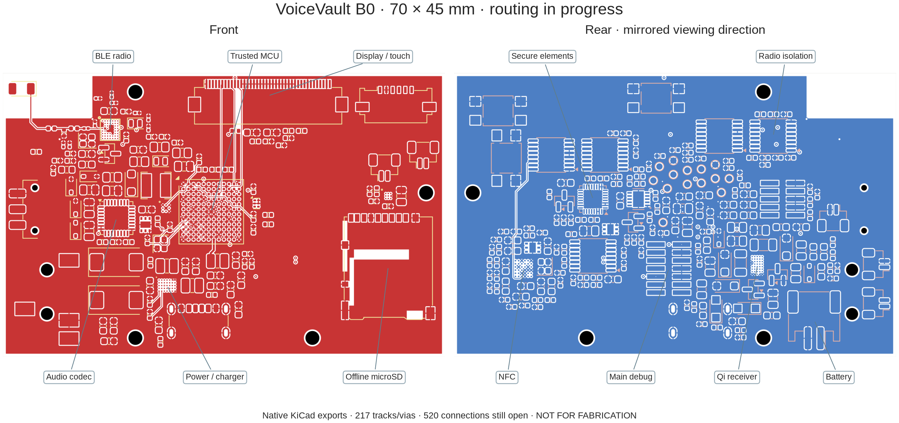

# VoiceVault standalone prototype B0

**Routing in progress — not a working or fabrication-ready PCB.**

VoiceVault moves plaintext voice, keys, contacts and call approval into a dedicated device. An already compromised phone carries encrypted records over BLE. This custom rectangular SMD board uses the identified **Trezor Safe 7 TS7 rev_D core ICs**, with added wired headset audio, physical microphone disconnect, offline microSD and separate computer-debug connections. It replaces the earlier development-board carrier as the active hardware design.

The current native KiCad project contains **296 electrical components, 14 board-only probe pads and four mounting holes** on a provisional **70 × 45 mm**, six-layer, 1.0 mm board. Components are placed on both sides. Available electrical and geometric checks pass, but **520 connections remain unrouted**, exact sourcing and HDI stackup are unresolved, and no physical board has been tested. [Machine-readable status](STATUS.json) · [Recorded evidence and images](../evidence/2026-11-12/README.md)



*Native KiCad exports, front and rear. RF copper and ground pours are present; most signal and power routing remains incomplete.*

## Open and inspect

From the repository root, run `./hardware/open`. The launcher opens one PCB editor and reuses it to limit memory use. Open `voicevault-standalone-b0.kicad_pro` in KiCad to inspect the root schematic and its **18 child sheets**. Keep the large schematic/3D viewers closed when running routing studies on this computer.

KiCad 10.0.8 uses the local `voicevault-kicad` MCP connection through its official IPC API. Circuit simulation uses **ngspice 47 directly**, preserving actual netlists, logs and measurements. MCP is useful for editor interaction; it is not required to run a command-line simulator. [Tool setup](../README.md)

```sh
./hardware/check --design-only --spice
```

This runs native schematic/pad/net checks, ST ball/function comparisons, ERC/DRC, an antenna-rule negative control, **799 ngspice model cases**, and the explicit power-allocation study. Exit 0 with `--design-only` means the available checks passed. The report still says **manufacturing blocked**. Without that option, exit 2 preserves the blocked release verdict. Exit 1 means a check failed. The historical carrier checks remain available as `./hardware/check --rev-a --design-only`.

## Circuit architecture

| Area | Current circuit intent |
|---|---|
| Trusted compute | STM32U5G9ZJJ6Q, UFBGA144, with local clocks, reset, decoupling and internal-SMPS network. The local symbol restores two power balls missing in the installed library. All 144 ball names and 29 selected peripheral functions are compared with separately pinned ST data. |
| Power and battery | nPM1300 dual 200 mA bucks/charger; USB power-only entry, diode-isolated Qi entry, protected battery connector and external cell-temperature input. USB has no D+/D− contacts. Charging configuration and thermal qualification remain open. |
| Secure elements | TROPIC01 and OPTIGA Trust M on MCU-only buses with local power gates. These circuits do not demonstrate lifecycle configuration, entropy quality or secret protection on real silicon. |
| Hostile radio boundary | nRF52832-CIAA with separate SWD and radio power, fixed-direction SN74AXC4T774 bridges, reset control and default-disabled interface. UART carries bounded records; the radio has no audio, secure-element or MCU-debug wires. Electrical fault containment still needs bench tests. |
| Voice | TLV320AIC3204, SAI1 full duplex, dedicated switched audio regulator, CTIA 3.5 mm headset jack, headphone DC-blocking networks, ESD parts and a physical microphone disconnect. All codec controls stay on the trusted MCU side. |
| Trusted interface | Newhaven 240 × 320 display/touch candidate, local reset/update buttons and DRV2624 haptic driver. These require new VoiceVault drivers; this is not the Safe 7 private display assembly. |
| Offline updates | Locally powered microSD SPI interface with default-disabled signal bridge. Signed-image, rollback and interrupted-update policies exist in the software model; they have not been ported and qualified as this board's boot/update firmware. |
| Qi | STWLC38 receiver, coil resonance/rectifier components, thermal sensing and disable path. Its host-control bus is separate from PMIC and secure-element buses. Matching, configuration, charging and temperature behavior are unqualified. |
| NFC | ST25R3916B with dedicated regulator, bridges and matching network; default-off intent. Firmware must require an explicit local enrollment action. An NFC transport is not itself proof of contact identity. |
| Bench access | Main STDC14 and independent Nordic SWD headers, 14 probe pads and removable audio-current link. Prototype debug access deliberately exposes memory/firmware to trusted lab equipment. |

Read [circuit and power review](CIRCUIT_REVIEW.md), [computer connection and bring-up](DEBUG_AND_BRINGUP.md), and [display/battery adaptations](DISPLAY_BATTERY_CANDIDATES.md) before hardware work.

## Exact reference and differences

The source is pinned to trezor/trezor-hardware commit `d99ad42320a19875c124445195fa56f0dbaff6db`. The actual Safe 7 MCU is **STM32U5G9ZJJ6Q in UFBGA144**, not the LQFP144 STM32U5G9ZJT6Q on the DK2 reference board. The earlier DK2 pin allocations and hardware measurements cannot be assumed to apply to this PCB. Actual silicon revision is not yet verified.

The ten core selections are STM32U5G9ZJJ6Q, nPM1300-CAAA, TPS3420DDRYR, STWLC38JRM, nRF52832-CIAA, ST25R3916B-BWLT, SLS32AIA010MKUSON10XTMA2, TPS61062YZFR, DRV2624YFFR and the TROPIC01 family. TPS61062's `R` suffix selects tape/reel packaging. **TROPIC01's orderable silicon/provisioning revision remains unresolved. OPTIGA's reference order code is NRND.** [Core source table](core-parts.csv)

The published Safe 7 release contains PDFs and board views; it does not supply a complete editable manufacturing project or its private display/battery assemblies. This is a new VoiceVault layout, with catalogue display/battery candidates and added audio/card/debug circuitry. AO3401A power-gate FETs are an explicit adaptation from the reference CSD25501F3. New crystals, antenna/coil geometry, power loads and enclosure need their own validation. No Trezor factory identities, attestation keys or certification are reproduced.

## What the evidence establishes

The native export and actual PCB pads agree for 1,026 schematic-connected nodes and 124 intentional NC pins. The schematic's 323 exported net records include those virtual NC records; the PCB has **199 named copper nets**. The latest available-check run has zero ERC issues and zero non-routing DRC violations. KiCad's detailed DRC list stops at 499 unconnected entries, so progress uses the independent full ratsnest count of 520 instead.

The antenna restriction is tested on a copy: headless KiCad rejects an unrelated track and a ground via inside the reserved area, and permits the RF-feed track. The live design is checked to remain unchanged. This verifies a CAD rule, not antenna performance or isolation from a physical attacker.

The 799 SPICE cases cover 27 passive MCU-supply sensitivities, 36 headphone cases, 32 microphone/contact cases and 704 static backlight load/fault cases. **They use explicit ideal sources and assumed impedances; no MCU, codec, converter control-loop, battery, RF or charging silicon model is supplied.** [Models, measurements and limits](SPICE_RESULTS.md)

The memory-limited Freerouting 2.5.0 trial on a copy reached fanout and then timed out without an accepted route. Nothing from it was applied to this board. It predates the final power/antenna-rule changes. The accepted board now has 168 track segments, 49 vias (14 laser) and four GND pours, including the RF feed, MCU switching-node connection, 14 MCU ground escapes, the PMIC capacitor connection and sixteen control nets. [Routing method, MCP acceptance and laser-via rules](ROUTING.md). The RF shunt ground vias have additional separation from SMD pads. All pad/net assignments and the antenna reservation are preserved. Most of the reduction from 853 to 520 connections comes from ground pours, not completed signal routing. Fine-pitch escapes, clock placement, power loops, signal routing, return paths and a factory-accepted stackup still require engineering work.

[Manufacturing-cost research](MANUFACTURING_COST.md) covers four assemblies delivered to Sweden. The routing target is a provisional six-layer first-order HDI construction, with purchasing left open. No supplier is proven cheapest by a complete delivered quotation.

## Manufacturing release is blocked

[circuit-inventory.csv](circuit-inventory.csv) lists every native electrical component and its current requirements. It is **not a JLCPCB assembly BOM**: generic passives, some connector/assembly variants, lifecycle issues and procurement acceptance are still unresolved. The source inventory of 243 upstream component-unit records is historical reference data, not this board's BOM.

Before fabrication: settle the HDI stackup and fine-pitch escape/pad process; complete package and electrical reviews; select/derate all parts; finish power/RF/signal routing and planes; pass full ERC/DRC and independent review; obtain exact BOM/CPL/DFM and inspection/test acceptance; then generate controlled manufacturing files. [Detailed gates and draft sourcing request](JLCPCB_SOURCING_REQUEST.md)

The battery, display, coil/ferrite, actuator, thermistors, harnesses and enclosure operations require explicit assembly scope. JLCPCB's public consignment terms exclude batteries. No order, purchase or supplier message has been sent. **No Gerber/CPL manufacturing release has been produced.**

The software threat model assumes NSA-class compromised phones/telecom and excludes supply-chain attacks. It does not turn this unbuilt board into a demonstrated secure device. Physical isolation, acoustic leakage, radio/charger faults, real entropy, boot protections and timing need assembled-board evidence. [Assurance case](../../docs/ASSURANCE.md)

## Sources and licensing

[Source manifest](reference/source-manifest.json), pinned ST ball data, manufacturer-source hashes and [library notices](LIBRARY_NOTICE.md) accompany the design. The new hardware adaptation uses [CERN-OHL-S-2.0](LICENSE); upstream and component-library notices retain their own terms. VoiceVault is independent and has no Trezor endorsement.
