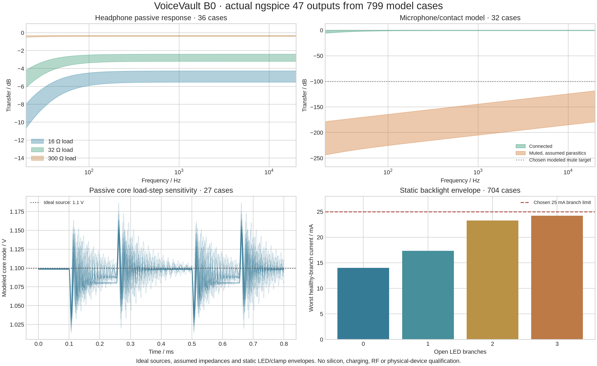

# B0 circuit-model results

Actual simulator: **ngspice 47**. Run `./hardware/check --design-only --spice` or the individual scripts under `hardware/tools/`. `VOICEVAULT_NGSPICE` can select another installation of the same version. Local case directories preserve each exact input circuit, raw data and log under `.lab-runs/hardware/standalone-b0/`.

| Experiment | Cases | Exercised inputs | Result within the stated model |
|---|---:|---|---|
| MCU core passive network | 27 | Three inductances, three capacitances per output bank and three DCR values; ideal 1.1 V source and 10→100 mA load | Minimum approximately 1.0137 V; maximum approximately 1.1866 V. No regulator stability/voltage-limit qualification. |
| Headphone coupling | 36 | 16/32/300 Ω loads, 176/220/264 µF, two ESR and two assumed output-resistance values, 10 Ω series resistors | Less than 1 dB additional loss at 100 Hz relative to 1 kHz in these passive cases. Output power, startup, distortion and acoustic safety are unmeasured. |
| Microphone / physical mute | 32 | Connected/muted, two contact resistances, two assumed off-capacitances, two input capacitances and two assumed ADC impedances | Modeled mute attenuation exceeds the chosen 100 dB target at 16 kHz. This is not an acoustic leakage or real switch/codec measurement. |
| Backlight sharing/faults | 704 | Eleven LED forward-voltage patterns, all sixteen open-branch masks, feedback/resistor corners and two assumed clamp envelopes | Worst healthy branch approximately 24.20 mA; worst modeled anode approximately 8.25 V. Converter silicon, temperature, startup, loop stability, brightness and fault duration are not modeled. |

The scripts cross-check selected audio/backlight resistor values with KiCad's native netlist. The models are engineering sensitivity experiments, not arbitrary random inputs and not a substitute for vendor silicon models. Each checks a named property and fails on a missing measurement or exceeded model threshold. The static backlight current source is explicitly ideal; its zener knee/slope and fixed LED forward voltages are assumptions.

The separate power-allocation study uses these outputs and documented current/efficiency assumptions. It is arithmetic design budgeting, not another SPICE silicon test and not evidence of battery life or safe charging. The 22 older Rev A cases remain historical and are not counted in the 799 B0 cases.

No simulation establishes that the complete device works, that it resists a physical fault attack, or that it meets the software threat model on real silicon. Those conclusions need board firmware, independent review and bench evidence.
