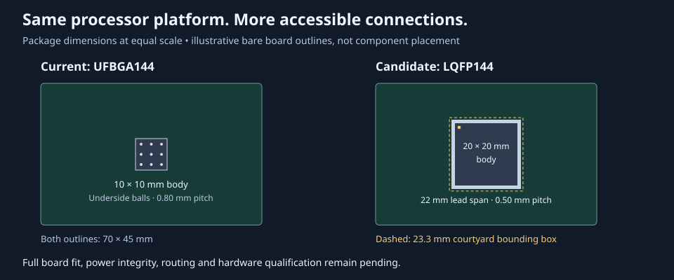

# STM32U5G9ZJT6Q prototype package evaluation

**16 November 2026 — recommended candidate, with one required pin correction. Evaluation only; no schematic, BOM, PCB, placement, copper or cloud job has been changed.**

Use **STM32U5G9ZJT6Q (LQFP144)** for the next serviceable prototype revision if easier assembly, inspection and escape routing take priority over minimum size. It preserves the selected STM32U5G9ZJ compute platform. It requires a new package-specific schematic and clean placement/routing; it cannot replace the BGA footprint on the existing layout. The repaired BGA checkpoint still has 62 opens and remains preserved.

## What changes and what stays

| Item | Current STM32U5G9ZJJ6Q | Candidate STM32U5G9ZJT6Q |
|---|---|---|
| Package | UFBGA144, underside balls | LQFP144, exposed perimeter leads |
| Body | 10 × 10 mm | 20 × 20 mm |
| Terminal pitch | 0.80 mm | 0.50 mm |
| Overall lead span | Body/ball matrix package | 22 × 22 mm nominal |
| Compute | Cortex-M33, up to 160 MHz | Same selected device family and core |
| Memory | 4 MB flash; 3026 KB SRAM with SRAM3 ECC off, 2962 KB with it on | Same |
| Security/peripherals | TrustZone, MPU, RNG, crypto peripherals, internal SMPS | Retained; implementation/configuration still need qualification |
| Board reference | Safe 7's selected MCU package | Exact part used on ST's STM32U5G9J-DK2 |

ST's pinned pin database identifies both as **DIE476**, with the same core, flash, SRAM, 101 I/Os and TrustZone availability. This is functional/package compatibility evidence, not proof that purchased chips have the same silicon revision or physical attack behavior. The full device remains larger and more complex than a wallet because it also has trusted audio, offline updates and its own power/control interfaces.

## Pin and peripheral audit

The audit reads the preserved clean C0 PCB, ST's exact-package XML data and the installed KiCad libraries on the host. It does not load the crash-prone KiCad Python runtime. Results and input hashes are in the [machine-readable report](../evidence/2026-11-16/lqfp-evaluation/report.json).

- All **55 connected non-supply signals** have corresponding LQFP pins. The current package has **91 connected pads including supplies/reference**.
- The installed LQFP symbol matches **all 144 physical pin names/numbers** in ST's pinned data, including both VDD11 and both VDD11DSI pins.
- The candidate footprint has 144 correctly numbered perimeter pads at 0.50 mm pitch. Its courtyard bounding box is **23.3 × 23.3 mm**. This checks the installed library's pin numbering and geometry; final stencil, mask and assembler acceptance remain separate.
- One **existing** hardware peripheral assignment fails in both packages: **SD_SCK_MCU on PC0**. PC0 supports SPI2_RDY, not SPI2_SCK. A GPIO-generated clock is possible in principle but is not a validated hardware-SPI/DMA implementation and is not the recommended remedy.
- Proposed correction: **move SD_SCK_MCU to unused PB13**, BGA ball M10 or **LQFP pin 70**, which supports SPI2_SCK. Keep PC1/SPI2_MOSI, PC2/SPI2_MISO and PC7/software CS. The proposed 55-signal assignment has no pin collisions and all intended pin functions exist. **This correction has not been applied.**

Previous ERC/pad-parity checks verified electrical consistency and selected critical nets; they did **not** establish every alternate-function assignment. This new finding is a functional release blocker for hardware-SPI operation even on the old BGA board. A fully routed PCB would not fix it.

| Interface | Retained GPIO assignment | LQFP pins | Audit scope |
|---|---|---|---|
| Hostile radio transport | USART2 TX PA2, RX PA3, RTS PA1, CTS PA0 | 38, 39, 37, 36 | Same USART instance and named functions |
| Audio full duplex | SAI1 A MCLK PE2, FS PE4, SCK PE5, playback PE6; B capture PE3 | 1, 3, 4, 5, 2 | A/B functions available; B must use the intended synchronous receive setup |
| Audio control | I2C2 SDA PF0, SCL PF1 | 10, 11 | Compatible pair |
| Display | SPI3 SCK PC10, MISO PC11, MOSI PC12 | 113, 114, 115 | Compatible trio; names describe panel SDO/SDI |
| Touch | I2C5 SDA PD0, SCL PD1 | 116, 117 | Compatible pair |
| Secure element | I2C4 SCL PD12, SDA PD13; enable PD10 | 77, 78, 75 | Dedicated trusted bus retained |
| microSD | Proposed SPI2 SCK PB13, MOSI PC1, MISO PC2; CS PC7 | 70, 30, 31, 99 | Corrects existing PC0 clock assignment |
| Backlight | PB9 / TIM4_CH4 | 140 | Hardware PWM function available |
| MCU development debug | PA13 SWDIO, PA14 SWCLK, PB3 SWO; NRST | 107, 111, 133, 28 | Existing development connector can be retained |
| Debug UART | USART6 RX PC8, TX PC9 | 100, 101 | Existing target RX/TX naming retained |
| Oscillators | HSE PH0/PH1; LSE PC14/PC15 | 26/27; 8/9 | Dedicated oscillator functions available |
| Boot | PH3 / BOOT0 | 138 | Strap and boot policy still require review |

Every connected signal is listed in [signal-migration.csv](../evidence/2026-11-16/lqfp-evaluation/signal-migration.csv). [all-lqfp-pins.csv](../evidence/2026-11-16/lqfp-evaluation/all-lqfp-pins.csv) covers all 144 target pins, including unused pins and supply groups. Repeated power pins are mapped by function, **not** by arbitrary one-to-one ball renumbering.

This is a pin capability audit, not an executed firmware test. Alternate-function register numbers, the actual clock tree, audio clock accuracy, SAI synchronization, DMA channel allocation, interrupt ownership, firmware driver availability and simultaneous operation remain to be checked during implementation and bench bring-up.

## Power and layout implications

The package has **ten VDD pins instead of eight**, ten ordinary VSS pins instead of twelve, **two VDD11DSI pins instead of one**, and two VSSDSI pins instead of three. Therefore a footprint-only swap or a reused BGA bypass-placement list is unsafe.

| Target supply/strap | LQFP pins | Proposed connection/review |
|---|---|---|
| Internal SMPS switch node | VLXSMPS 64 | MCU_LX → external L1 → MCU_VDD11; keep switching copper compact |
| SMPS supply and return | VDDSMPS 65, VSSSMPS 66 | Main 3.3 V and ground with local input bypass/return |
| Core regulated supply | VDD11 67 and 142 | MCU_VDD11, never directly 3.3 V; preserve ST's required core capacitance |
| DSI supplies, even with SPI display | VDDDSI 13; VDD11DSI 14 and 20 | VDDDSI to VDD, both VDD11DSI to VDD11 as required by DS14102 |
| Analog/reference | VSSA 33, VREF+ 34, VDDA 35 | Retain ground/3.3 V policy; review reference-buffer configuration and local bypass |
| Other supply domains | VBAT 6, VDDUSB 108, VDDIO2 131 | Preserve reviewed supply functions; VBAT is the MCU backup-domain input, not a raw lithium-cell input |

Rebuild the decoupling plan around the physical LQFP pins, including the extra VDD and VDD11DSI locations. Keep ST's total core-capacitance and SMPS-inductor requirements, and check DC-bias derating. ST specifies typical 4.7 µF total on VDD11 and a typical 2.2 µH SMPS inductor; component values alone do not qualify the switching loop. Longer cross-package core connections, grounding, power sequencing, oscillator placement and the audio/RF return paths need a fresh layout review.

The 23.3 mm footprint courtyard can fit geometrically inside a bare **70 × 45 mm** outline. That is **not** proof that all 213 existing footprints, connector access, battery/display assemblies and antenna exclusions fit together. The body area grows fourfold and the courtyard bounding box consumes about 17% of one board face before external bypass parts and routing corridors. Keep the present outline as a first study target; allow a larger rectangular serviceable prototype if placement cannot meet the actual constraints.

The routing advantage comes from exposing every lead at the perimeter, **not** from wider lead pitch. Tracks can leave the pads outward without escaping inner BGA rows. Assembly inspection, probing and rework should be easier. It still needs sensible placement and ordinary vias outside the leads; fine pitch, solder bridges and return-path interruptions remain possible. It does not guarantee Quilter completion, fewer layers, or a lower assembled price. Start with the existing provisional six-layer stack and qualify any later layer reduction separately.

## Security and silicon revision

Changing this package does not change the trusted endpoint architecture or the approved X25519 + ML-KEM-768 / ChaCha20-Poly1305 software suite. The SE050E2 remains a separate identity-key device, the hostile radio remains outside the trusted audio/key boundary, and contacts/local consent remain on the trusted device. MCU GPIO/peripheral security attribution, DMA access, signed offline boot/update handling and production debug policy must still be implemented and tested on real hardware.

ST's **ES0595 Rev 4 (July 2026)** covers this device and lists **revision Z, REV_ID 0x1001**. The order code does not guarantee a particular delivered die revision. Record package markings and read DBGMCU_IDCODE during bring-up; gate firmware workarounds against the observed revision. Relevant errata include SPI receive configuration and end-of-transfer behavior, plus the system, DMA, RNG and security-related sections. Changing from BGA to LQFP does not remove these limitations. Development SWD access remains useful for the prototype and is not production lockdown.

## Sourcing and next implementation gate

ST lists the LQFP order code as active. JLCPCB lists it as **C22445371**, LQFP144 20 × 20 mm. This establishes a catalog identity only: stock, price for four assembled units, silicon revision, assembly fees, taxes and shipping to Sweden are unconfirmed. No purchasing, reservation, quote submission, paid service or fabrication order was made.

If adopted, the next work is a separate C1 circuit revision: replace U1's symbol/footprint, apply the SD-clock correction, remap **all** power pins, update decoupling and manufacturing metadata, and run native ERC/netlist parity plus the expanded peripheral audit. Generate a clean placement/routing input without importing BGA copper. Let Quilter choose placement/routing with the actual package, oscillator/SMPS/bypass proximity constraints, antenna rules and connector access. Accept a returned board only after native zone refill and full DRC/connectivity, followed by electrical/mechanical/RF/power review. Neither a routing percentage nor this package evaluation is a manufacturing release.

## Sources and evidence

- [ST STM32U5G9ZJ product/order-code page](https://www.st.com/en/microcontrollers-microprocessors/stm32u5g9zj.html).
- [DS14102 Rev 5](https://www.st.com/resource/en/datasheet/stm32u5g9zj.pdf): Figure 9, Table 27, AF tables, supply overview and §6.3 package information. Viewed through the web reader; direct local PDF download failed, so no local PDF hash is asserted.
- [UM3223 Rev 2, DK2 board manual](https://www.st.com/resource/en/user_manual/um3223-discovery-kit-with-stm32u5g9zj-mcu-stmicroelectronics.pdf).
- [ES0595 Rev 4](https://www.st.com/resource/en/errata_sheet/es0595-stm32u5fxxx-and-stm32u5gxxx-device-errata-stmicroelectronics.pdf).
- Official [LQFP pin data](https://github.com/STMicroelectronics/STM32_open_pin_data/blob/7d1f1514ed5583ec5007ad91236b4e1d377295b1/mcu/STM32U5G9ZJTxQ.xml) and [BGA pin data](https://github.com/STMicroelectronics/STM32_open_pin_data/blob/7d1f1514ed5583ec5007ad91236b4e1d377295b1/mcu/STM32U5G9ZJJxQ.xml), pinned to the same commit. Derived data attribution/license: [ST BSD-3-Clause](../rev-b/reference/ST_PIN_DATA_LICENSE.txt).
- [JLCPCB catalog entry](https://jlcpcb.com/partdetail/STMicroelectronics-STM32U5G9ZJT6Q/C22445371), identity only.
- [Audit evidence and reproduction instructions](../evidence/2026-11-16/lqfp-evaluation/README.md).
