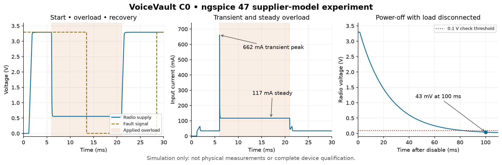

# VoiceVault Rev C — simpler hardware, preserved trust boundary

**Native circuit draft, not a manufacturing release.** C0 implements the approved simplification in a separate KiCad project. Initial circuit checks and scoped ngspice studies are recorded. The entire electrical inventory remains unplaced and unrouted for Quilter. Live B0 CAD, backups and earlier cloud results are preserved.

[Open the KiCad project](voicevault-standalone-c0.kicad_pro) · [Root schematic](voicevault-standalone-c0.kicad_sch) · [PCB input](voicevault-standalone-c0.kicad_pcb) · [Checked evidence](../evidence/2026-11-16/rev-c/README.md) · [Decisions](decisions.json) · [Manufacturer reference hashes](references.json)

## Component reduction

| Inventory | Preserved B0 | C0 draft | Reduction |
|---|---:|---:|---:|
| Electrical components | 296 | **205** | **91, about 31%** |
| Probe pads | 14 | 13 | 1 |
| Mounting holes | 4 | 4 | 0 |
| Total PCB footprints | 314 | **222** | **92, about 29%** |

The dedicated Qi and NFC sheets contained 45 and 44 components respectively. Removing them eliminates 89 old parts; replacing the charger/power system and two secure elements changes the net total further. Replacement regulators, protection, temperature-sensor connections, pullups and power controls are included in the final 205 count. This is circuit inventory, not an assembler-approved purchasing BOM. The selected replaceable battery, holder, display assembly, enclosure and external accessories require separate sourcing and mechanical acceptance.

## Circuit changes now present

| Area | Implemented in the C0 draft | Remaining acceptance |
|---|---|---|
| Compute | STM32U5G9ZJJ6Q UFBGA144, existing clocks/reset, local controls and development debug | Fine-pitch escape feasibility, peripheral/firmware bring-up, lifecycle/debug lockdown |
| Identity/security | **One SE050E2HQ1/Z01Z3Z**, replacing TROPIC01 and OPTIGA; MCU I2C4 and enable control | Delivered applet/OS revision, errata, provisioning, authenticated channel, drivers and persistence semantics |
| BLE | **nRF52832-QFAA-G-R7**, QFN48 6 × 6 mm; package-specific pin map, decoupling and primary RF matching | Antenna placement constraints, reference return paths, VNA tuning and hostile-radio bench tests |
| Battery | Protected single-cell **BL-5C-style Li-ion** pack through a JST-PH-2 harness; separate real 10 kΩ NTC connection | Exact protected pack, holder/retention, polarity, thermal contact, current and temperature limits |
| Wired charging | **BQ24074RGTR**, system power path, nominal 201 mA charging, real NTC, charge/input status | Battery approval, full charging/thermal/fault studies and load budget |
| Charging input | Fused/TVS-protected power-only USB-C, two 5.1 kΩ CC resistors; no USB data to phone or MCU | Source/input compliance, power integrity, ESD and abnormal-input qualification |
| Main supply | **TPS63070RNMR**, 1.5 µH XFL4020 inductor, nominal 3.296 V buck-boost, local hard switch and undervoltage divider | Complete converter transient/stability model and bench evidence |
| Radio supply | **TPS2553DBVR** current limiter, default-off enable, fault feedback and passive output discharge | Whole-system fault containment, load extremes and real discharge/backfeed checks |
| microSD | **TPS22918DBVR** switched supply and retained isolated interface | Card current/transients, power-loss behavior, firmware/offline-update integration |
| Audio | **TPS7A2028PDBVR** low-noise 2.8 V audio supply; retained TLV320AIC3204, wired jack and physical microphone disconnect | Codec supply sequencing/configuration, headroom, noise, acoustic and DMA tests |
| Display and haptics | Retained trusted color display/touch and DRV2624 haptics; independent haptic I2C pullups | Assembly fit, fine-pitch escape, driver and trusted UI qualification |
| Removed | Qi receiver/coil path, NFC reader/antenna path, both old secure elements and superseded power management | Verify returned layout contains no removed interfaces or unintended shared-net dependency |

The larger radio uses Nordic's QFN reference rather than copying its WLCSP RF circuit: DEC2 is unconnected in the selected reference configuration and the primary RF values change. The [pin-migration table](ble-pin-migration.csv) covers all 48 perimeter terminals plus exposed ground. Package land geometry for NXP, the main converter and inductor is recorded in [package-geometry.json](package-geometry.json); it still needs independent assembly review. The `VoiceVault_B0` library namespace is retained for reused component assets; this does not reuse old PCB copper or component placement.

The local hard switch replaces the old power-management arrangement. Charging remains connected while the system is switched off. JP501 defaults to the 100 mA input configuration; selecting the 500 mA option requires an appropriate source policy. This input choice is not a demonstration of universal USB compliance. BSI on a BL-5C-style pack is **not** assumed to be a temperature sensor. A separate physically coupled sensor is required; a fixed resistor must not bypass battery temperature safety.

## Security boundary retained

The STM32 owns plaintext audio, call approval, verified contacts and session keys. The radio and phone remain hostile ciphertext carriers, with no direct secure-element bus, audio or main MCU debug connection. Wired charging carries power only. Separate debug connectors are for development; production debug lockdown remains a release gate.

Calls keep fresh **X25519 + ML-KEM-768**, authenticated transcript/peer/suite binding, mandatory hybrid selection, **ChaCha20-Poly1305**, replay controls, fixed-size/cadence audio and local consent. In-person enrollment compares the full 256-bit transcript fingerprint on both trusted displays and requires confirmation on each. NFC is unnecessary for that comparison. [Threat model](../../docs/THREAT_MODEL.md) · [Security controls](../../docs/SECURITY_CONTROLS.md) · [Cryptographic design](../../docs/CRYPTOGRAPHY.md)

SE050E2 is selected for internal Ed25519 operations and its disabled contactless interface; other variants are not interchangeable. Identity keys are intended to be generated and used internally without export. Its internal identity-key generation uses its own RNG. Separately, session entropy must require passing contributions from **both STM32 and NXP**, with no phone/radio fallback. The existing model requires at least two of three source slots; the absent second secure element must be reported unavailable, never replaced with synthetic entropy. Physical randomness and independence remain unmeasured. [NXP configuration](https://www.nxp.com/docs/en/application-note/AN12436.pdf) · [Command specification](https://www.nxp.com/docs/en/application-note/AN12413.pdf)

Real secure-channel provisioning, protected counter deletion/reset policy, contact generations, antirollback floors, endurance and power-loss atomicity still require a chip-specific implementation. No production NXP driver, real MCU DMA implementation or completed firmware is supplied by this CAD change. Removing one security chip is an engineering simplification; these circuit checks do not establish equivalent physical attack resistance.

## What was checked

On **16 November 2026**, using **KiCad 10.0.8** and **ngspice 47**:

- Native netlist/pad correspondence: **845 connected nodes**; **62 independently specified critical pin/net checks** and **four corrupt-net negative controls** passed.
- Native electrical-rule check: **zero violations**. Native unplaced-inventory DRC: **zero layout violations and zero schematic-parity findings**.
- Native PCB inspection: **222 footprints**, all electrical/probe footprints unlocked and unplaced outside the outline; **zero tracks, vias or copper pours**. Four existing mounting-hole geometries remain.
- **772** passive audio/backlight sensitivity cases and **16** secure-bus RC cases passed within their stated assumptions.
- The supplier radio-switch model passed startup, current limiting, fault reporting, recovery and unloaded discharge. A narrow PSpice Boolean-syntax port is recorded and checked against **12 independently expected logic outputs**. Original supplier files remain unchanged.
- Six regression tests ensure simulator aborts, nonzero exits and missing/non-finite measurements cannot become passes, including the observed exit-zero abort failure mode.
- Main regulator supplier model: **BLOCKED** after a bounded timeout and a numerical timestep abort. No complete main-supply/charger/MCU/secure-element simulation is claimed.

The unplaced board has **603 missing connections**, by the full native connectivity count. KiCad's JSON DRC list truncates at 499 items; that is not the true total. These are expected before layout. Zero clearance errors in an off-board inventory does **not** mean a routed board passed final DRC.



*Simulation, not hardware measurement. The radio rail reaches about 3.293 V, settles to about 117 mA during overload, reports fault, recovers, and falls to about 43 mV after 100 ms unloaded discharge. The initial overload transient peaks at about 662 mA; the steady limit is not an instantaneous peak limit. This does not establish complete electrical fault isolation.*

The feedback allocation is 3.258–3.334 V before switching ripple/transients. Datasheet arithmetic places charging at approximately 179–223 mA and radio current limiting at 99–139 mA. These are separately labeled arithmetic estimates, not additional SPICE chip simulations. Actual routed I2C capacitance, charging temperature, supply transients and RF behavior are unmeasured.

## Reproduce the available checks

From the repository root, with the existing KiCad Flatpak and ngspice toolchain installed:

```sh
python3 hardware/tools/fetch_rev_c_references.py
./hardware/check --rev-c --design-only --spice
```

The downloader verifies pinned public supplier archives and extracts only the reviewed model files into the ignored cache. Supplier PDFs/models are not redistributed under the project's license. Changed hashes require review. `--all` also fetches the pinned reference PDFs. A model or numerical failure cannot count as a successful full-device simulation.

Results go to `.lab-runs/hardware/standalone-c0/`, including native XML, pad inspection, ERC/DRC JSON, SPICE inputs/logs/waveforms and the report. `--design-only` can pass available circuit checks while manufacturing stays blocked. Without that option the command returns a blocked release result. The default `./hardware/check`, single-editor launcher and MCP still target preserved B0; use the explicit Rev C command and C0 project when inspecting this revision. The checker uses a small isolated CLI configuration and runs checks serially to reduce memory pressure; user GUI settings are preserved.

To regenerate a disposable unplaced C0 copy, use `prepare_rev_c.py`, `make_rev_c_packages.py` and `create_standalone_draft.py --design-dir hardware/rev-c --project-name voicevault-standalone-c0 --unplaced`. The generator refuses to overwrite routed/zone-bearing work. Regeneration is not a way to merge a future Quilter return.

## Before placement and manufacture

1. Complete RF/antenna and connector/mechanical placement constraints, low-inductance power-loop/return requirements and remaining fine-pitch escape feasibility. All actual electrical placement and routing belongs to Quilter; no competing local routing pass.
2. Resolve the converter model or obtain another defensible stability/transient analysis; complete charging/thermal/fault analysis and accept the exact pack/holder/sensor and input/load policy. The provisional outline remains 70 × 45 mm, six layers, 1.0 mm. Layer/via rules are not a manufacturer-approved process.
3. Start a separate clean Rev C Quilter job only with a checked, constrained input. Recheck returned component identities, pad nets, antenna rules, stack, actual copper, full connectivity and native DRC. Completion percentage alone is not acceptance.
4. Implement and test NXP provisioning, entropy, persistence and MCU peripherals. Qualify actual power, audio/DMA, trusted UI, radio isolation, acoustic leakage and offline updates on physical prototypes.
5. Prepare an assembler-approved BOM and manufacturing files only after those release gates. Four fully assembled prototypes delivered to Sweden remain the procurement target. **No purchase, paid service, order or manufacturing submission has been made.**

The focused existing software lifecycle suite passed 18 tests on 15 November before this CAD work. That result is retained as historical policy evidence; it is not a new full software-suite verdict or validation of these physical chips. The [assurance case](../../docs/ASSURANCE.md) keeps simulation, bounded proofs and physical qualification distinct.
